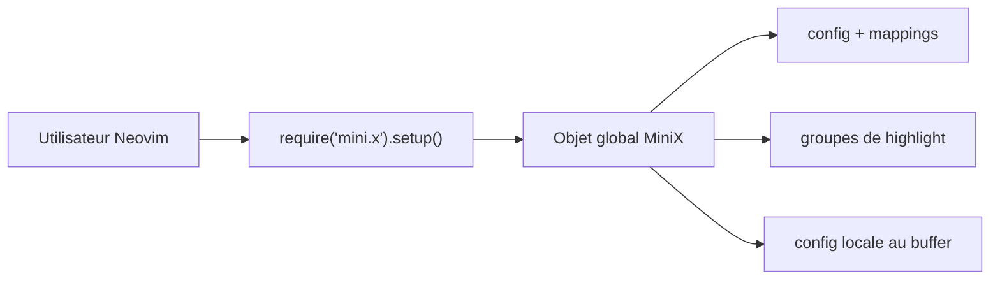

# nvim-mini/mini.nvim

> Collection de plus de 45 modules Lua indépendants qui complètent Neovim, pour qui configure son éditeur.

## Le problème
Neovim nu demande d'empiler des dizaines de plugins aux conventions différentes. Chacun se configure à sa façon.

## Ce que ça fait vraiment
Fournit des modules séparés : édition (ai, surround, pairs, comment), workflow (files, pick, clue, git, diff), apparence (statusline, icons, hues) et divers (doc, test). Chaque module s'active par son propre `setup()`, crée un objet global `MiniXxx` et reste utilisable sans les autres. Pas de fonctionnalité propre à un langage : choix assumé.

## Comment c'est branché


## Essayer
```bash
# Neovim 0.12+, dans init.lua :
vim.pack.add({ 'https://github.com/nvim-mini/mini.nvim' })
# lazy.nvim :
{ 'nvim-mini/mini.nvim', version = false },
```

## Coût et pièges
Gratuit. Neovim 0.10 minimum ; chaque module doit appeler `setup()` sinon rien ne s'active. Sous Windows, chemins trop longs possibles à l'installation.

## Ce que ce n'est pas
Pas une distribution Neovim prête à l'emploi (MiniMax en est un exemple de config). Pas de support par langage. Les modules « planifiés » listés n'existent pas encore.

## Alternatives
- folke/lazy.nvim : gestionnaire de plugins, que mini.nvim n'oblige pas à utiliser (mini.deps existe aussi).

## Pour toi
À adopter si tu passes du temps dans Neovim : un seul dépôt cohérent remplace une dizaine de plugins, avec un mainteneur actif.

