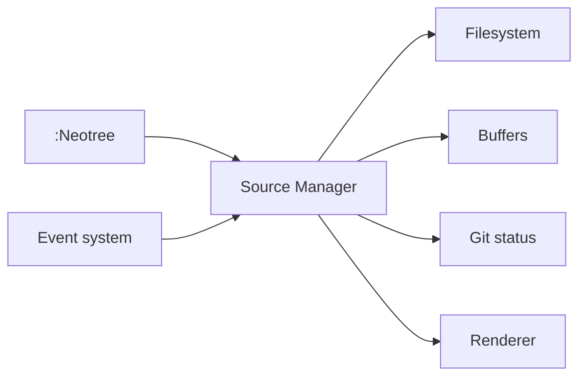

# nvim-neo-tree/neo-tree.nvim

> Neovim plugin that displays a file tree, buffers and Git state in a sidebar or floating window.

## The problem
Neovim's file explorers are often temperamental and can break on update.

## What it actually does
A source manager provides `filesystem`, `buffers`, `git_status` and `document_symbols` (experimental). It handles add, copy, delete and rename, filtering, preview, following the current file and file system watching. Stated promise: no breaking changes within a major version. Depends on nui.nvim and plenary.nvim.

## How it is wired


## Trying it
```bash
:Neotree
:checkhealth neo-tree
```

## Cost and gotchas
Free. Neovim 0.8 or later; `v3.x` branch recommended. A single active maintainer is cited.

## What it is not
Not an editor nor an IDE: an explorer. The `document_symbols` source is experimental.

## Alternatives
nvim-tree.lua is cited as a source of inspiration, without comparison.

## For you
To watch: pleasant if you code in Neovim, with no effect on the substance of your data/AI/MLOps work.
