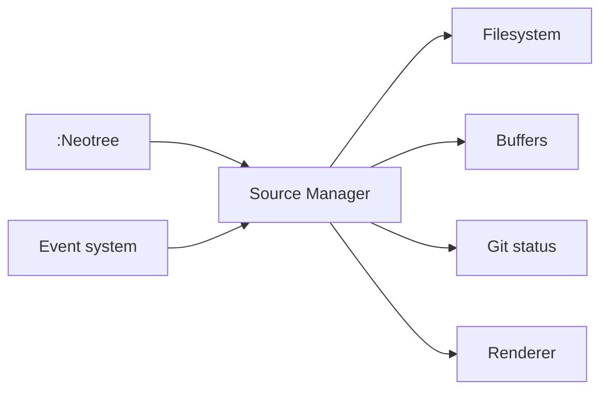

# nvim-neo-tree/neo-tree.nvim

> Plugin Neovim qui affiche arborescence de fichiers, tampons et état Git en barre latérale ou fenêtre flottante.

## Le problème
Les explorateurs de fichiers de Neovim sont souvent capricieux et peuvent casser lors d'une mise à jour.

## Ce que ça fait vraiment
Un gestionnaire de sources fournit `filesystem`, `buffers`, `git_status` et `document_symbols` (expérimental). Il gère ajout, copie, suppression et renommage, filtre, prévisualisation, suivi du fichier courant et surveillance du système de fichiers. Promesse affichée : aucun changement cassant dans une version majeure. Dépend de nui.nvim et plenary.nvim.

## Comment c'est branché


## Essayer
```bash
:Neotree
:checkhealth neo-tree
```

## Coût et pièges
Gratuit. Neovim 0.8 ou plus ; branche `v3.x` recommandée. Un seul mainteneur actif est cité.

## Ce que ce n'est pas
Pas un éditeur ni un IDE : un explorateur. La source `document_symbols` est expérimentale.

## Alternatives
nvim-tree.lua est cité comme source d'inspiration, sans comparaison.

## Pour toi
À surveiller : agréable si tu codes sous Neovim, sans effet sur le fond de ton travail data/IA/MLOps.

