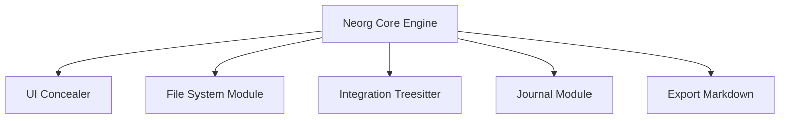

# nvim-neorg/neorg

> Neovim plugin in Lua for taking notes and managing tasks in a single text format.

## The problem
Notes, tasks, journal and documents live in separate tools with different formats.

## What it actually does
Everything rests on a `.norg` file format. Modules cover syntax concealing, presentation, journal, task tracking, Markdown export and LaTeX rendering, with treesitter integration and completion.

## How it is wired


## Trying it
```lua
require("neorg").setup()
```

## Cost and gotchas
Free, Neovim 0.10 or later and luarocks for lazy.nvim. Version 9.0.0 with breaking changes; pin the version. GPL-3.0 license.

## What it is not
Not a standalone note-taking tool: it requires Neovim and a careful configuration. The README admits occasional workflow changes.

## Alternatives
No alternative named in the README.

## For you
Ignore: only useful if you live in Neovim and want a plain-text note system, unrelated to AI.
