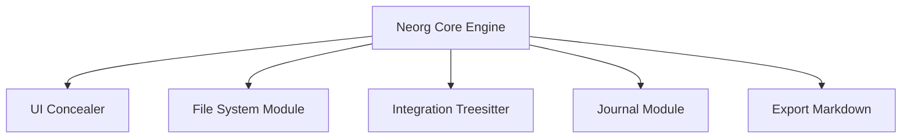

# nvim-neorg/neorg

> Extension Neovim en Lua pour prendre des notes et gérer des tâches dans un format texte unique.

## Le problème
Notes, tâches, journal et documents vivent dans des outils séparés avec des formats différents.

## Ce que ça fait vraiment
Tout repose sur un format de fichier `.norg`. Les modules couvrent le masquage de syntaxe, la présentation, le journal, le suivi des tâches, l'export Markdown et le rendu LaTeX, avec intégration treesitter et complétion.

## Comment c'est branché


## Essayer
```lua
require("neorg").setup()
```

## Coût et pièges
Gratuit, Neovim 0.10 ou plus et luarocks pour lazy.nvim. Version 9.0.0 avec changements incompatibles ; épingler la version. Licence GPL-3.0.

## Ce que ce n'est pas
Ce n'est pas un outil de notes autonome : il faut Neovim et une configuration soignée. Le README admet des changements de flux occasionnels.

## Alternatives
Aucune alternative nommée dans le README.

## Pour toi
À ignorer : utile seulement si tu vis dans Neovim et veux un système de notes en texte brut, sans lien avec l'IA.

