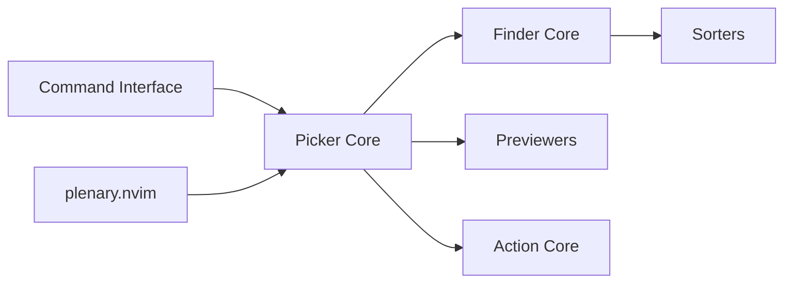

# nvim-telescope/telescope.nvim

> Extensible fuzzy finder for Neovim: files, grep, buffers, git, LSP.

## The problem
Quickly finding a file, a string or a symbol in a project from within the editor.

## What it actually does
A picker queries a finder (asynchronous, one-shot or static task), a sorter ranks the results, a previewer displays them, and actions run on the selection. Built-in pickers (files, git, LSP, Treesitter), themes, layouts, community extensions.

## How it is wired


## Trying it
```lua
{
    'nvim-telescope/telescope.nvim', version = '*',
    dependencies = { 'nvim-lua/plenary.nvim' }
}
```
Then `:Telescope find_files` and `:checkhealth telescope`.

## Cost and gotchas
Free. Neovim ≥ 0.11.7 with LuaJIT, plenary.nvim; ripgrep required for `live_grep`. Only the latest stable release and the branch head are supported.

## What it is not
Not a data analysis tool: an editor plugin.

## Alternatives
snacks.picker, mini.pick, fzf-lua, fzf.vim, denite.nvim, vim-clap (listed under "Related Projects").

## For you
Ignore: a plugin for Neovim users; changes nothing to your data / AI work unless you already edit in Neovim.
