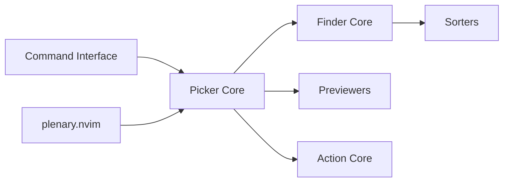

# nvim-telescope/telescope.nvim

> Chercheur flou extensible pour Neovim : fichiers, grep, tampons, git, LSP.

## Le problème
Trouver vite un fichier, une chaîne ou un symbole dans un projet depuis l'éditeur.

## Ce que ça fait vraiment
Un picker interroge un finder (tâche asynchrone, one-shot ou statique), un sorter classe, un previewer affiche, des actions s'exécutent sur la sélection. Pickers intégrés (fichiers, git, LSP, Treesitter), thèmes, mises en page, extensions communautaires.

## Comment c'est branché


## Essayer
```lua
{
    'nvim-telescope/telescope.nvim', version = '*',
    dependencies = { 'nvim-lua/plenary.nvim' }
}
```
Puis `:Telescope find_files` et `:checkhealth telescope`.

## Coût et pièges
Gratuit. Neovim ≥ 0.11.7 avec LuaJIT, plenary.nvim ; ripgrep requis pour `live_grep`. Seules la dernière version stable et la tête de branche sont supportées.

## Ce que ce n'est pas
Pas un outil d'analyse de données : un plugin d'éditeur.

## Alternatives
snacks.picker, mini.pick, fzf-lua, fzf.vim, denite.nvim, vim-clap (listés en « Related Projects »).

## Pour toi
Ignorer : plugin pour utilisateurs de Neovim ; ne change rien à ton travail data / IA sauf si tu édites déjà sous Neovim.

