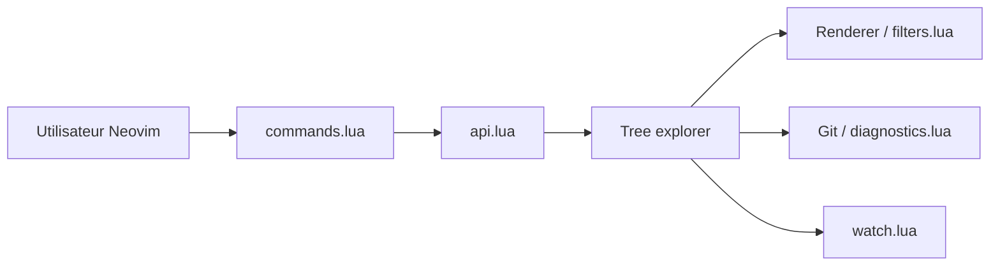

# nvim-tree/nvim-tree.lua

> File explorer written in Lua for Neovim, for those who want a side tree with Git and diagnostics.

## The problem
The built-in file browser (netrw) is austere and has no Git or LSP integration.

## What it actually does
Displays the project tree, updates automatically, shows icons, Git status and LSP/COC diagnostics. Allows filtering, creating, renaming, deleting, and cut/copy/paste between instances. Everything goes through a public API that the `:NvimTree*` commands call.

## How it is wired


## Trying it
```lua
vim.g.loaded_netrw = 1
vim.g.loaded_netrwPlugin = 1
require("nvim-tree").setup()
-- puis :NvimTreeOpen
```

## Cost and gotchas
Free. Neovim ≥ 0.10; disable netrw at the very start of `init.lua`. Icons require nvim-web-devicons and a Nerd Font.

## What it is not
Not a file manager outside Neovim. Neovim versions older than n-0.1 no longer receive support.

## Alternatives
No alternative named in the README.

## For you
Adopt if you code in Neovim: well established and highly configurable; check the license, which GitHub does not identify.
