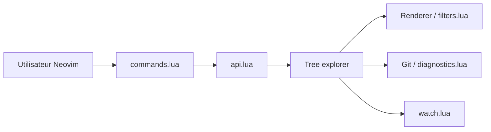

# nvim-tree/nvim-tree.lua

> Explorateur de fichiers en Lua pour Neovim, pour qui veut un arbre latéral avec Git et diagnostics.

## Le problème
Le navigateur de fichiers natif (netrw) est austère et sans intégration Git ni LSP.

## Ce que ça fait vraiment
Affiche l'arbre du projet, se met à jour automatiquement, montre les icônes, l'état Git et les diagnostics LSP/COC. Permet filtrage, création, renommage, suppression, couper/copier/coller entre instances. Tout passe par une API publique que les commandes `:NvimTree*` appellent.

## Comment c'est branché


## Essayer
```lua
vim.g.loaded_netrw = 1
vim.g.loaded_netrwPlugin = 1
require("nvim-tree").setup()
-- puis :NvimTreeOpen
```

## Coût et pièges
Gratuit. Neovim ≥ 0.10 ; désactiver netrw dès le début de `init.lua`. Les icônes demandent nvim-web-devicons et une police Nerd Font.

## Ce que ce n'est pas
Pas un gestionnaire de fichiers hors Neovim. Les versions de Neovim plus anciennes que n-0.1 ne reçoivent plus de support.

## Alternatives
Aucune alternative nommée dans le README.

## Pour toi
À adopter si tu codes dans Neovim : bien établi et très configurable ; vérifie la licence, que GitHub n'identifie pas.

