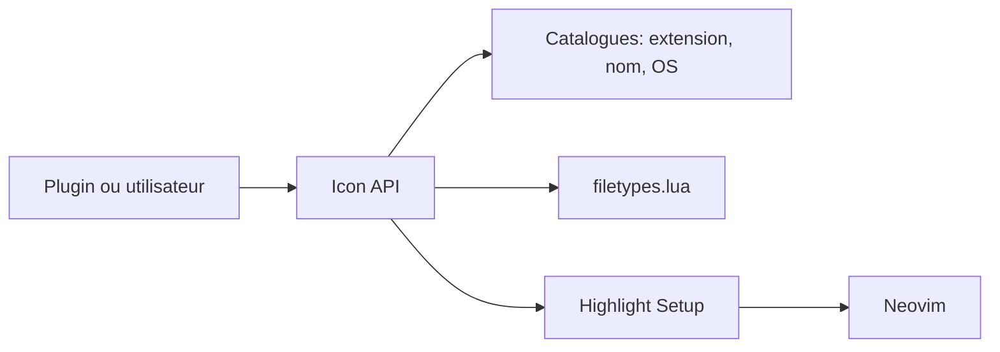

# nvim-tree/nvim-web-devicons

> Provides Nerd Font icons by extension or file name to Neovim plugins.

## The problem
Every Neovim plugin that displays files needs consistent icons and colors.

## What it actually does
Lua API that returns, for a name, extension or file type, the icon and its color (light/dark variants). Lets you override or add icons, get all icons, and define highlight groups. The `:NvimWebDeviconsHiTest` command displays them. Requires Neovim 0.7+ and Nerd Font 3.3+.

## How it is wired


## Trying it
```bash
# dans Neovim
:NvimWebDeviconsHiTest
```
```lua
vim.pack.add({ { src = 'https://github.com/nvim-tree/nvim-web-devicons' } })
require'nvim-web-devicons'.setup { default = true }
```

## Cost and gotchas
Free. An up-to-date Nerd Font is needed: breaking changes exist (tags `nerd-v3.2-compat`, `nerd-v2-compat`). Faulty rendering on Windows/WSL with some terminals (Alacritty).

## What it is not
Not a plugin visible on its own: it serves as a dependency for others.

## Alternatives
vim-devicons, of which this is a Lua fork.

## For you
Watch: already pulled in as a dependency if you use Neovim, nothing to adopt separately.
