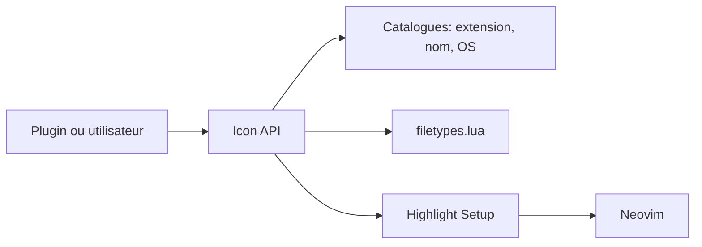

# nvim-tree/nvim-web-devicons

> Fournit des icônes Nerd Font par extension ou nom de fichier aux plugins Neovim.

## Le problème
Chaque plugin Neovim qui affiche des fichiers a besoin d'icônes et de couleurs cohérentes.

## Ce que ça fait vraiment
API Lua qui renvoie, pour un nom, une extension ou un type de fichier, l'icône et sa couleur (variantes claire/sombre). Possibilité de surcharger ou d'ajouter des icônes, d'obtenir toutes les icônes, de définir les groupes de surlignage. Commande `:NvimWebDeviconsHiTest` pour les voir. Nécessite Neovim 0.7+ et une Nerd Font 3.3+.

## Comment c'est branché


## Essayer
```bash
# dans Neovim
:NvimWebDeviconsHiTest
```
```lua
vim.pack.add({ { src = 'https://github.com/nvim-tree/nvim-web-devicons' } })
require'nvim-web-devicons'.setup { default = true }
```

## Coût et pièges
Gratuit. Il faut une Nerd Font à jour : des ruptures existent (tags `nerd-v3.2-compat`, `nerd-v2-compat`). Rendu défaillant sous Windows/WSL avec certains terminaux (Alacritty).

## Ce que ce n'est pas
Pas un plugin visible seul : il sert de dépendance à d'autres.

## Alternatives
vim-devicons, dont c'est un fork en Lua.

## Pour toi
À surveiller : déjà tiré comme dépendance si tu utilises Neovim, rien à adopter à part.

