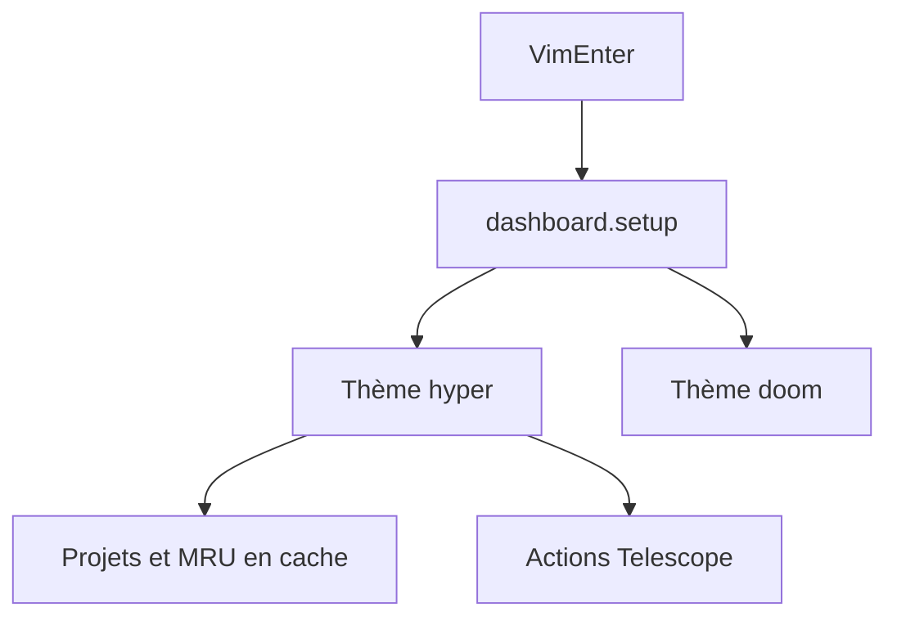

# nvimdev/dashboard-nvim

> Neovim plugin that replaces the start screen with a configurable dashboard.

## The problem
When Neovim opens without a file, the screen is empty: no shortcuts, no recent projects or files.

## What it actually does
The plugin displays two themes, `hyper` (shortcuts, projects, recent files, number of loaded plugins) and `doom` (centered menu). The header, footer and actions are configurable. The configuration is only kept in memory until a file is opened. The commands are `Dashboard`, `DbProjectDelete` and `DashboardUpdateFooter`.

## How it is wired
Simplified diagram based on the sheet, no diagram provided.



## Trying it
```lua
{
  'nvimdev/dashboard-nvim',
  event = 'VimEnter',
  config = function()
    require('dashboard').setup {
      -- config
    }
  end,
  dependencies = { {'nvim-tree/nvim-web-devicons'}}
}
```

## Cost and gotchas
Free. Depends on nvim-web-devicons, and on Telescope for some actions in the examples.

## What it is not
It is not a session manager: the README removed that feature and points to glepnir/dbsession.nvim. The announced image support remains a to-do.

## Alternatives
glepnir/dbsession.nvim, for the session management this plugin no longer provides.

## For you
Ignore: cosmetic Neovim comfort, unrelated to data / AI / MLOps work.
