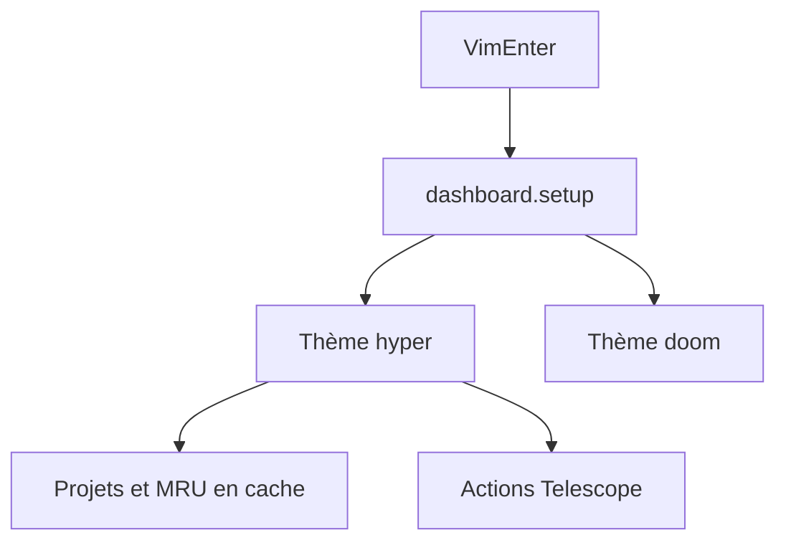

# nvimdev/dashboard-nvim

> Plugin Neovim qui remplace l'écran d'accueil par un tableau de bord configurable.

## Le problème
À l'ouverture de Neovim sans fichier, l'écran est vide : pas de raccourcis, ni de projets ou fichiers récents.

## Ce que ça fait vraiment
Le plugin affiche deux thèmes, `hyper` (raccourcis, projets, fichiers récents, nombre de plugins chargés) et `doom` (menu centré). L'en-tête, le pied et les actions sont configurables. La configuration n'est gardée en mémoire que jusqu'à l'ouverture d'un fichier. Les commandes sont `Dashboard`, `DbProjectDelete` et `DashboardUpdateFooter`.

## Comment c'est branché
Schéma simplifié d'après la fiche, sans diagramme fourni.



## Essayer
```lua
{
  'nvimdev/dashboard-nvim',
  event = 'VimEnter',
  config = function()
    require('dashboard').setup {
      -- config
    }
  end,
  dependencies = { {'nvim-tree/nvim-web-devicons'}}
}
```

## Coût et pièges
Gratuit. Dépend de nvim-web-devicons, et de Telescope pour certaines actions des exemples.

## Ce que ce n'est pas
Ce n'est pas un gestionnaire de sessions : le README a retiré cette fonction et renvoie vers glepnir/dbsession.nvim. Le support d'images annoncé reste une tâche à faire.

## Alternatives
glepnir/dbsession.nvim, pour la gestion de sessions que ce plugin n'assure plus.

## Pour toi
À ignorer : confort cosmétique de Neovim, sans lien avec le travail data / IA / MLOps.

