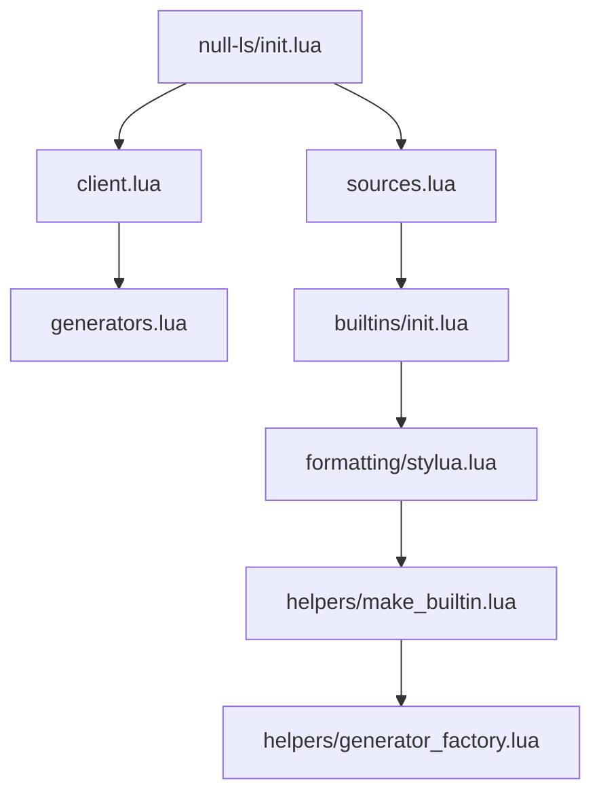

# nvimtools/none-ls.nvim

> Community fork of null-ls: turns Neovim into an LSP server for formatting, diagnostics and code actions.

## The problem
Neovim does not let non-LSP sources (formatters, CLI linters) plug into its LSP client.

## What it actually does
Starts an in-memory LSP client, with no external process, that dispatches requests to registered sources: code actions, diagnostics, formatting, hover, completion. Built-in sources (stylua, mypy, gitsigns) and helpers launch the command-line tools. Taken over after null-ls was abandoned; the repository name changed, not the API.

## How it is wired


## Trying it
```lua
local null_ls = require("null-ls")
null_ls.setup({ sources = { null_ls.builtins.formatting.stylua } })
```

## Cost and gotchas
Free. Depends on plenary.nvim; each source requires its tool to be installed. Tests target the latest stable Neovim version; the announced status is beta. Many sources have migrated to none-ls-extras.nvim.

## What it is not
Not a real LSP server. Not a collection of tools: formatters and linters still need to be installed.

## Alternatives
- nvim-lint: diagnostics only.
- formatter.nvim: formatting only.
- efm-langserver: general external server.

## For you
Watch: handy for plugging ruff, mypy or black into Neovim, if that is your editor.
