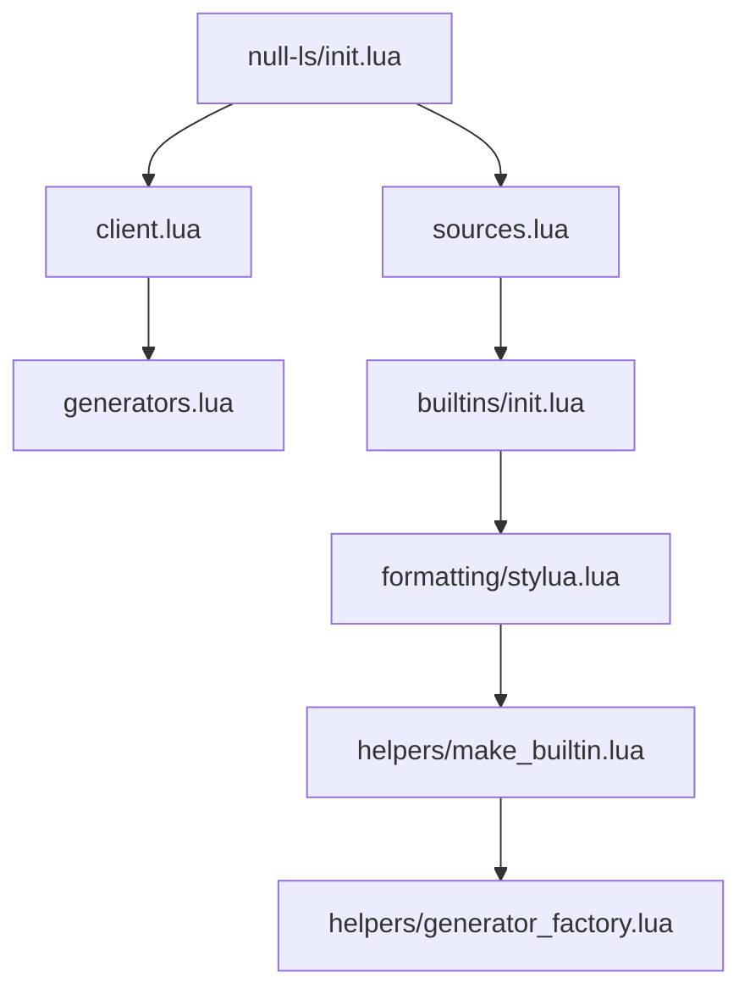

# nvimtools/none-ls.nvim

> Fork communautaire de null-ls : fait de Neovim un serveur LSP pour formatage, diagnostics et actions de code.

## Le problème
Neovim ne permet pas à des sources non LSP (formateurs, linters en CLI) de s'insérer dans son client LSP.

## Ce que ça fait vraiment
Démarre un client LSP en mémoire, sans processus externe, qui dispatche les requêtes aux sources enregistrées : actions de code, diagnostics, formatage, survol, complétion. Des sources intégrées (stylua, mypy, gitsigns) et des aides lancent les outils en ligne de commande. Repris après l'abandon de null-ls ; le nom du dépôt a changé, pas l'API.

## Comment c'est branché


## Essayer
```lua
local null_ls = require("null-ls")
null_ls.setup({ sources = { null_ls.builtins.formatting.stylua } })
```

## Coût et pièges
Gratuit. Dépend de plenary.nvim ; chaque source exige son outil installé. Les tests ciblent la dernière version stable de Neovim ; le statut annoncé est beta. Beaucoup de sources ont migré vers none-ls-extras.nvim.

## Ce que ce n'est pas
Pas un vrai serveur LSP. Pas une collection d'outils : les formateurs et linters restent à installer.

## Alternatives
- nvim-lint : diagnostics seulement.
- formatter.nvim : formatage seulement.
- efm-langserver : serveur général externe.

## Pour toi
Surveiller : pratique pour brancher ruff, mypy ou black dans Neovim, si c'est ton éditeur.

