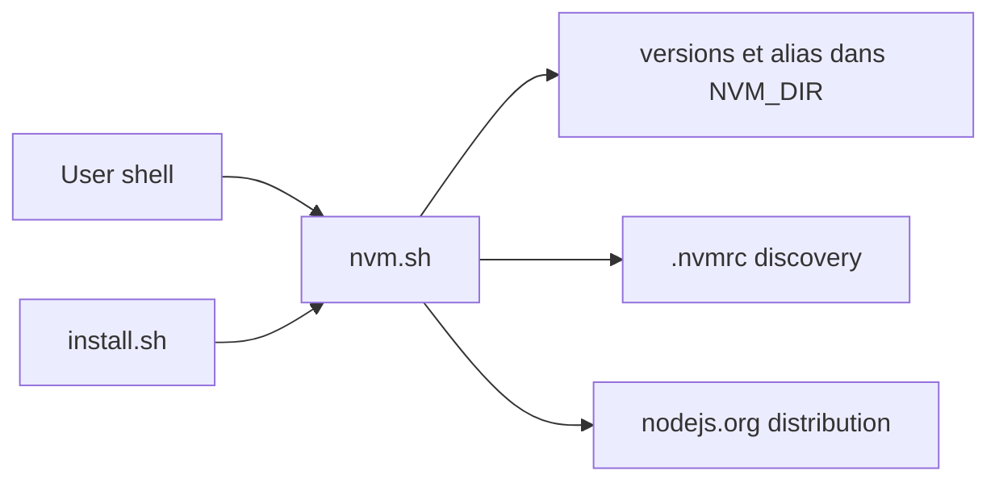

# nvm-sh/nvm

> Node.js version manager in POSIX shell, installed per user and invoked per session.

## The problem
Several projects require different Node versions, and a single global Node breaks one of them.

## What it actually does
`nvm.sh` is a library of functions sourced in bash or zsh. It downloads Node binaries (or compiles from source), stores them in `$NVM_DIR/versions`, manages aliases and a `.nvmrc` file searched in parent directories, and adjusts PATH, MANPATH and NODE_PATH. Mirrors are configurable. Fish is not supported.

## How it is wired


## Trying it
```bash
curl -o- https://raw.githubusercontent.com/nvm-sh/nvm/v0.40.8/install.sh | bash
command -v nvm
nvm install 24
nvm use 22
```

## Cost and gotchas
Free. Requires git, curl or wget, and a C++ compiler if compiling from source is needed. Only one active maintainer according to the README.

## What it is not
Not a binary: it is a shell function, so `which nvm` does not work. Not compatible with fish nor installable via Homebrew. Not for native Windows.

## Alternatives
nvm-windows, nodist and nvs for Windows; several tools for fish, cited in the README.

## For you
Adopt for reproducible Node environments, with a `.nvmrc` per repository; the risk is dependence on a single maintainer.
