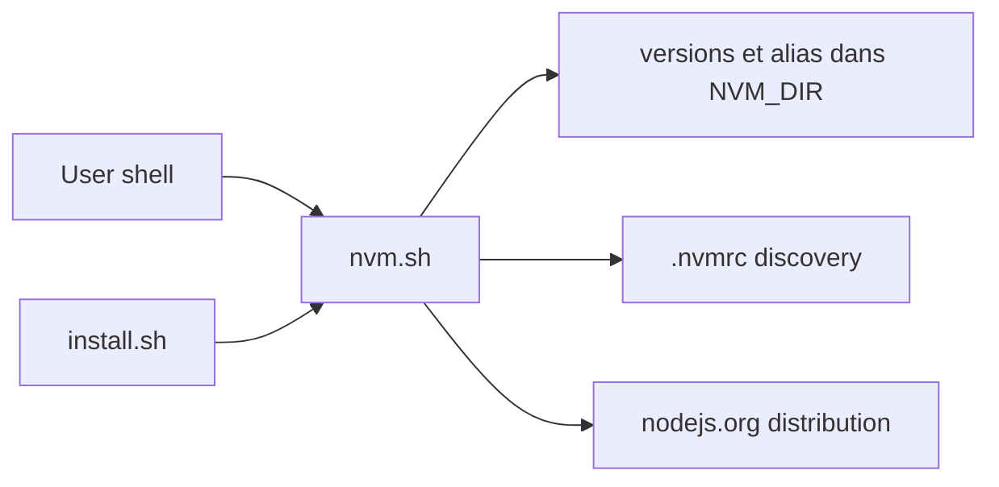

# nvm-sh/nvm

> Gestionnaire de versions de Node.js en shell POSIX, installé par utilisateur et invoqué par session.

## Le problème
Plusieurs projets exigent des versions de Node différentes, et un seul Node global casse l'un d'eux.

## Ce que ça fait vraiment
`nvm.sh` est une bibliothèque de fonctions sourcée dans bash ou zsh. Elle télécharge les binaires Node (ou compile depuis les sources), les range dans `$NVM_DIR/versions`, gère des alias et un fichier `.nvmrc` cherché dans les dossiers parents, et ajuste PATH, MANPATH et NODE_PATH. Miroirs configurables. Fish n'est pas pris en charge.

## Comment c'est branché


## Essayer
```bash
curl -o- https://raw.githubusercontent.com/nvm-sh/nvm/v0.40.8/install.sh | bash
command -v nvm
nvm install 24
nvm use 22
```

## Coût et pièges
Gratuit. Nécessite git, curl ou wget, et un compilateur C++ si une compilation depuis les sources est nécessaire. Un seul mainteneur actif selon le README.

## Ce que ce n'est pas
Pas un binaire : c'est une fonction de shell, donc `which nvm` ne marche pas. Pas compatible fish ni installable via Homebrew. Pas pour Windows natif.

## Alternatives
nvm-windows, nodist et nvs pour Windows ; plusieurs outils pour fish, cités dans le README.

## Pour toi
À adopter pour des environnements Node reproductibles, avec un `.nvmrc` par dépôt ; le risque est la dépendance à un mainteneur unique.

