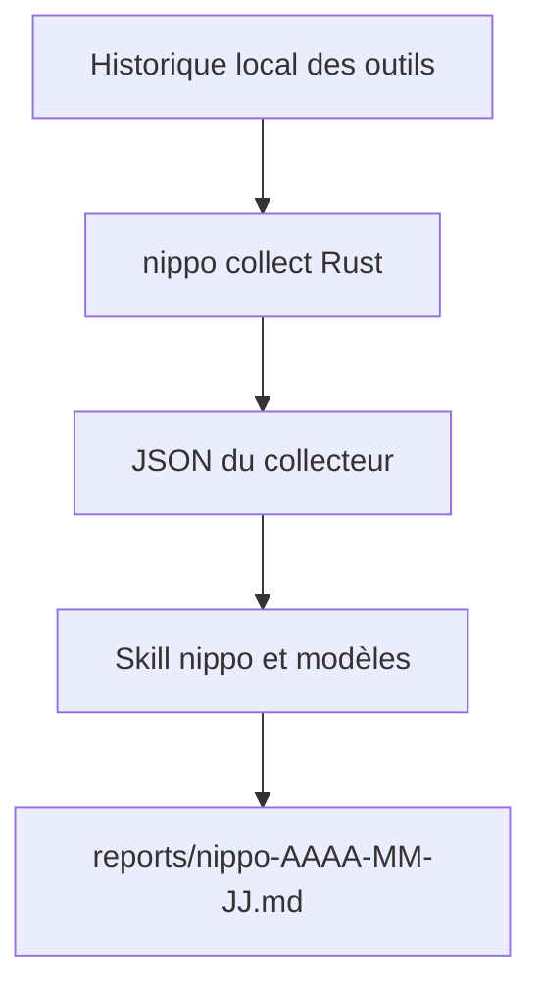

# nwiizo/nippo

> Generates daily reports and retrospectives from the local history of Claude Code, Codex and opencode.

## The problem
Manually copying what you did in your agent sessions into a daily report or retrospective is tedious.

## What it actually does
A Rust collector reads the local session history (Claude Code, Codex, opencode) and produces an aggregated JSON. A `nippo` skill formats that JSON using templates: report, retrospective, plan, guide, self-assessment, trends, blocker ledger. The files are written to `reports/`.

## How it is wired


## Trying it
```bash
cargo install nippo
nippo skill install
nippo collect --period today
nippo ledger --export
```
Then `/nippo` in Claude Code or `$nippo` in Codex.

## Cost and gotchas
Free. Rust 1.89 or later and SQLite 3.45.3 or later are needed to build it. The reports contain your work and your thoughts: review them before sharing. README in Japanese.

## What it is not
Not a quality evaluator: the author states that the skill's review is not an automatic accuracy check. The counts rely on sessions containing user statements.

## Alternatives
Claude Code's `/insights` command: it improves how you use Claude Code, not how you work.

## For you
Relevant if you work a lot with coding agents and want a logbook; lightweight installation, worth testing before adopting.
