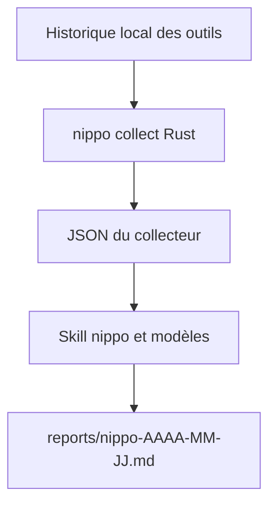

# nwiizo/nippo

> Génère des rapports journaliers et bilans à partir de l'historique local de Claude Code, Codex et opencode.

## Le problème
Recopier à la main ce qu'on a fait dans ses sessions d'agent pour un rapport quotidien ou un bilan est fastidieux.

## Ce que ça fait vraiment
Un collecteur en Rust lit l'historique local des sessions (Claude Code, Codex, opencode) et produit un JSON agrégé. Une skill `nippo` met ce JSON en forme selon des modèles : rapport, bilan, plan, guide, auto-évaluation, tendances, registre des blocages. Les fichiers sortent dans `reports/`.

## Comment c'est branché


## Essayer
```bash
cargo install nippo
nippo skill install
nippo collect --period today
nippo ledger --export
```
Puis `/nippo` dans Claude Code ou `$nippo` dans Codex.

## Coût et pièges
Gratuit. Rust 1.89 ou plus et SQLite 3.45.3 ou plus pour compiler. Les rapports contiennent ton travail et tes réflexions : à relire avant de les partager. README en japonais.

## Ce que ce n'est pas
Pas un évaluateur de qualité : l'auteur précise que la relecture par la skill n'est pas un contrôle automatique d'exactitude. Les comptes s'appuient sur les sessions avec propos de l'utilisateur.

## Alternatives
La commande `/insights` de Claude Code : améliore l'usage de Claude Code, non la façon de travailler.

## Pour toi
Pertinent si tu travailles beaucoup avec des agents de code et veux un journal de bord ; installation légère, à tester avant d'adopter.

