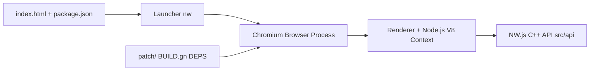

# nwjs/nw.js

> Runtime combining Chromium and Node.js for writing desktop applications in HTML and JavaScript.

## The problem
Shipping a desktop application with web technologies, while calling Node modules directly from the page.

## What it actually does
NW.js runs an app described by a `package.json` and an HTML page inside a Chromium that embeds Node.js, in the same thread and the same heap. The page code can therefore call Node modules directly. It exists for Linux, macOS and Windows, with an SDK build, and SHA-256 sums and GPG signatures let you verify the binaries. Based on the architecture: launcher, browser process, renderer with a V8 context, C++ API, Chromium and Node patches.

## How it is wired


## Trying it
```bash
/path/to/nw .
curl -O https://dl.nwjs.io/vx.y.z/SHASUMS256.txt
grep nwjs-vx.y.z.tar.gz SHASUMS256.txt | sha256sum -c -
```

## Cost and gotchas
Free. Use the SDK build for development. On macOS, the binary is inside the `.app` bundle. Version cited: 0.116.0 (Node.js 26.7.0, Chromium 153).

## What it is not
Not a server-side web tool or a testing framework: a runtime for desktop applications.

## Alternatives
- No alternative named in the README.

## For you
Ignore: packaging a web app as a desktop application is not relevant to a data/AI/MLOps workflow.
