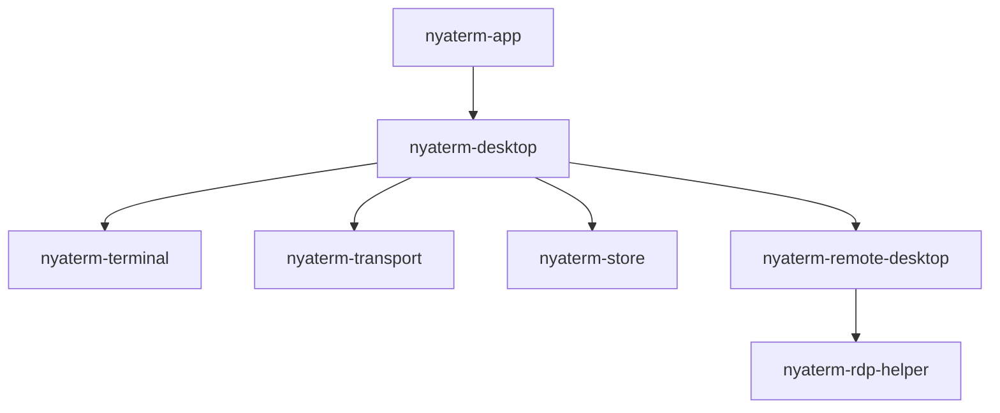

# nyakang/nyaterm

> Native desktop client in Rust for SSH, local terminals, SFTP and remote sessions, with an AI assistant.

## The problem
Administrators juggle a terminal, an SFTP client, a password manager and remote desktop tools.

## What it actually does
A GPUI application brings together SSH, local shell, Telnet, serial port, RDP and VNC in a workspace of tabs and panes. It includes an SFTP explorer with a transfer queue, tunnels, jump hosts, OTP, and monitoring of remote resources, NVIDIA GPUs and Docker. An AI assistant generates commands, explains outputs and runs approved actions. Encrypted sync goes through WebDAV, S3 or GitHub Gist.

## How it is wired


## Trying it
```bash
brew install nyakang/nyaterm/nyaterm
git clone https://github.com/nyakang/nyaterm.git
cd nyaterm
cargo run -p nyaterm-app --bin nyaterm
```

## Cost and gotchas
Free; the AI assistant requires a model provider's API key, billed by that provider. The application is not signed on macOS (remove the quarantine attribute). Migration from 1.x is manual on Windows.

## What it is not
It is not a shell replacement: it connects to shells. The assistant does not become an autonomous agent without approval of risky commands.

## Alternatives
No alternative named in the README (it cites WindTerm and tabby as inspirations).

## For you
Watch: an SSH client with remote GPU and Docker monitoring could help manage your training machines, but it is young and run by one person.
