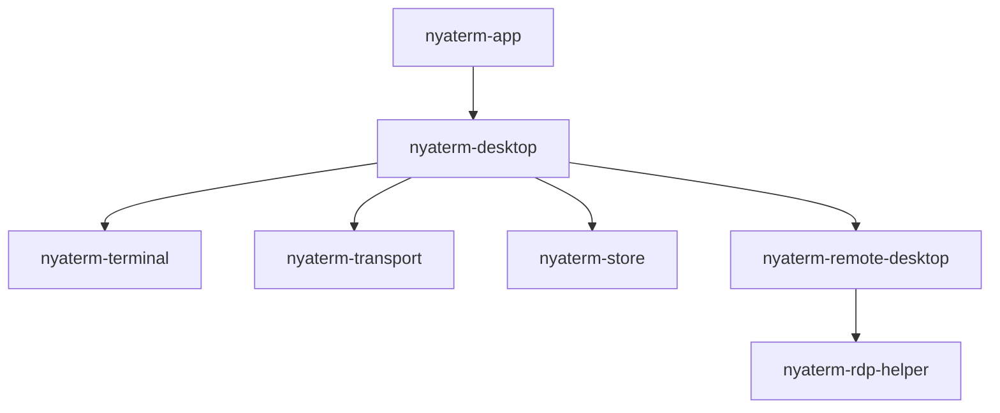

# nyakang/nyaterm

> Client de bureau natif en Rust pour SSH, terminaux locaux, SFTP et sessions distantes, avec assistant IA.

## Le problème
Les administrateurs jonglent entre terminal, client SFTP, gestionnaire de mots de passe et outils de bureau à distance.

## Ce que ça fait vraiment
Une application GPUI réunit SSH, shell local, Telnet, port série, RDP et VNC dans un espace à onglets et volets. Elle intègre un explorateur SFTP avec file de transferts, tunnels, hôtes de rebond, OTP, supervision de ressources, GPU NVIDIA et Docker distants. Un assistant IA génère des commandes, explique des sorties et exécute des actions approuvées. La synchronisation chiffrée passe par WebDAV, S3 ou GitHub Gist.

## Comment c'est branché


## Essayer
```bash
brew install nyakang/nyaterm/nyaterm
git clone https://github.com/nyakang/nyaterm.git
cd nyaterm
cargo run -p nyaterm-app --bin nyaterm
```

## Coût et pièges
Gratuit ; l'assistant IA exige la clé d'un fournisseur de modèles, facturée par lui. L'application n'est pas signée sur macOS (retirer l'attribut de quarantaine). Migration depuis 1.x manuelle sous Windows.

## Ce que ce n'est pas
Ce n'est pas un remplaçant de shell : il se connecte à des shells. L'assistant ne devient pas un agent autonome sans approbation des commandes à risque.

## Alternatives
Aucune alternative nommée dans le README (il cite WindTerm et tabby comme inspirations).

## Pour toi
À surveiller : un client SSH avec supervision GPU et Docker distants peut servir à gérer tes machines d'entraînement, mais il est jeune et porté par une personne.

