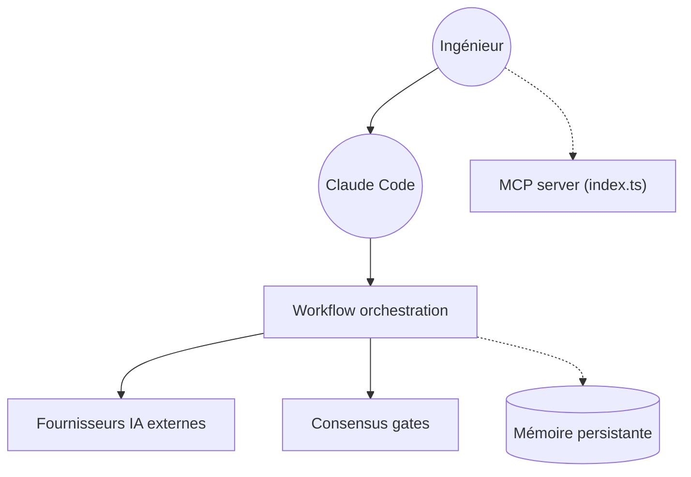

# nyldn/claude-octopus

> Claude Code plugin that has work reviewed and debated by several models, with consensus gates.

## The problem
A single model has blind spots and nobody challenges its choices before delivery.

## What it actually does
The plugin adds `/octo:*` commands (embrace, council, debate, research, review, tdd, security, factory…), 31 personas and skills. It can query up to twelve external providers (Codex, Copilot, Qwen, Ollama, Perplexity, OpenRouter, Grok, Kimi…) and applies a 75% consensus threshold. It stays inactive until you invoke a command. There is also an MCP server for Cursor and a design token extraction pipeline.

## How it is wired


## Trying it
```bash
claude plugin marketplace add https://github.com/nyldn/plugins.git
claude plugin install octo@nyldn-plugins
/octo:setup
```

## Cost and gotchas
No external provider is required to get started, but every multi-model call consumes your subscriptions or API keys. The `OCTOPUS_AUTO_ROUTER_MODE=invoke` mode can launch paid workflows and share your prompts with providers. Native Windows is not supported: use WSL.

## What it is not
Not a project affiliated with Anthropic, as the README states. Not a replacement for Claude Code: it adds to it for escalation.

## Alternatives
- Superpowers: a single method for one agent, without multi-provider consensus.

## For you
Worth watching: useful for multi-opinion reviews, but heavy on options, run by one person, and costly once several providers are enabled.
