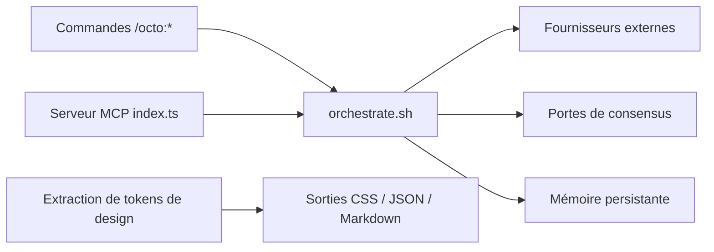

# nyldn/claude-octopus

> Plugin Claude Code qui orchestre plusieurs modèles et applique un seuil de consensus avant de livrer.

## Le problème
Un seul modèle a des angles morts : revue, recherche ou architecture gagnent à être recoupées par d'autres modèles.

## Ce que ça fait vraiment
Ajoute les commandes `/octo:*` (embrace, council, debate, research, tdd, security, factory…). Les workflows sont explicites et restent dormants sinon. Jusqu'à douze fournisseurs externes (Codex, Copilot, Ollama, Perplexity, OpenRouter, Cursor CLI, Grok, Kimi Code…) ; porte de consensus à 75 %, personas, mémoire entre sessions, serveur MCP pour Cursor et autres. Mode « Dark Factory » spec → logiciel.

## Comment c'est branché


## Essayer
```bash
claude plugin marketplace add https://github.com/nyldn/plugins.git
claude plugin install octo@nyldn-plugins
/octo:setup
```

## Coût et pièges
Claude seul suffit pour démarrer ; les fournisseurs externes passent par abonnements ou clés d'API. Un run complet est estimé à 1 à 6 dollars ou plus. Linux et macOS seulement, sous Windows via WSL.

## Ce que ce n'est pas
Pas affilié à Anthropic. Le routage automatique, désactivé par défaut, enverrait des prompts aux fournisseurs externes.

## Alternatives
- obra/superpowers : méthodologie structurée pour un seul agent, comparée dans le README.

## Pour toi
À surveiller : le croisement multi-modèles aide pour des revues sensibles, mais l'ampleur (63 skills, 54 commandes) et le coût en tokens appellent un essai ciblé avant adoption.

