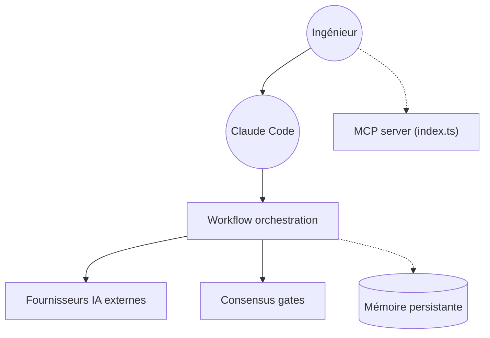

# nyldn/claude-octopus

> Plugin Claude Code qui fait relire et débattre le travail par plusieurs modèles, avec des portes de consensus.

## Le problème
Un seul modèle a des angles morts et personne ne contredit ses choix avant livraison.

## Ce que ça fait vraiment
Le plugin ajoute des commandes `/octo:*` (embrace, council, debate, research, review, tdd, security, factory…), 31 personas et des skills. Il peut interroger jusqu'à douze fournisseurs externes (Codex, Copilot, Qwen, Ollama, Perplexity, OpenRouter, Grok, Kimi…) et applique un seuil de consensus à 75 %. Il reste inactif tant que tu n'invoques pas une commande. Il existe aussi un serveur MCP pour Cursor et un pipeline d'extraction de tokens de design.

## Comment c'est branché


## Essayer
```bash
claude plugin marketplace add https://github.com/nyldn/plugins.git
claude plugin install octo@nyldn-plugins
/octo:setup
```

## Coût et pièges
Aucun fournisseur externe n'est requis pour démarrer, mais chaque appel multi-modèle consomme tes abonnements ou clés d'API. Le mode `OCTOPUS_AUTO_ROUTER_MODE=invoke` peut lancer des workflows payants et partager tes prompts avec des fournisseurs. Windows natif non supporté : passer par WSL.

## Ce que ce n'est pas
Pas un projet affilié à Anthropic, comme le README le précise. Pas un remplaçant de Claude Code : il s'y ajoute pour l'escalade.

## Alternatives
- Superpowers : une seule méthode pour un agent, sans consensus multi-fournisseurs.

## Pour toi
À surveiller : utile pour des revues à plusieurs avis, mais très chargé en options, porté par une personne, et coûteux dès qu'on active plusieurs fournisseurs.

