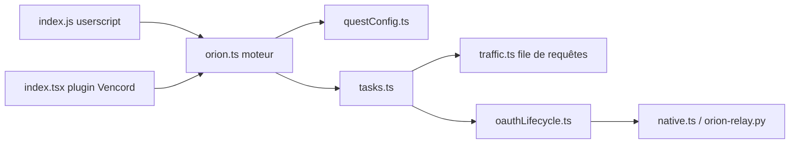

# nyxxbit/discord-quest-completer

> Script and Vencord plugin that complete Discord Quests without playing them, at the risk of an account sanction.

## The problem
Discord Quests ask you to play, watch or stream in exchange for rewards (Orbs, decorations). The tool automates this.

## What it actually does
It reads Discord's webpack stores and drives its API client. For games, it injects a fake process; for videos, it sends timed progress updates; for "achievement in activity" quests, it authorizes the app via OAuth2 and posts forged progress to `discordsays.com`. Streaming quests do not work. Two forms: a userscript to paste into DevTools, or a Vencord plugin.

## How it is wired


## Trying it
```bash
# Console DevTools de Discord : coller le contenu de index.js, puis Entrée
# Activer la console sur Discord Stable : éditer %appdata%/discord/settings.json
# { "DANGEROUS_ENABLE_DEVTOOLS_ONLY_ENABLE_IF_YOU_KNOW_WHAT_YOURE_DOING": true }
```

## Cost and gotchas
Free, but Discord has been sanctioning automation since April 2026: a 14-day restriction is documented, and a risk to the whole account is not ruled out. Bypassing achievements is the riskiest. Windows only for the installers; breaks with every Discord change.

## What it is not
Not a safe tool: it violates Discord's terms of service, as the README says. No guarantee against Discord updates.

## Alternatives
- markterence/discord-quest-completer: dummy executables, more durable, but games only and Windows only.
- nicola02nb/completeDiscordQuest: Vencord plugin, broken by the application ID change.
- nvckai/Discord-Web-Auto-Quest-Extension: Chrome extension, videos only.

## For you
Ignore: a tool outside the data/AI scope that puts your account at risk.
