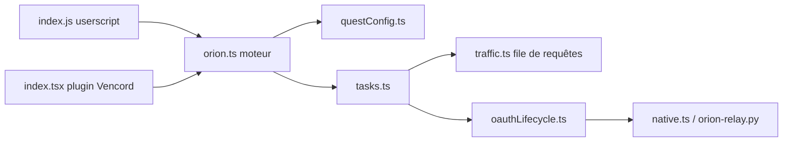

# nyxxbit/discord-quest-completer

> Script et plugin Vencord qui valident les Quêtes Discord sans les jouer, au risque d'une sanction du compte.

## Le problème
Les Quêtes Discord demandent de jouer, regarder ou streamer pour des récompenses (Orbs, décorations). L'outil automatise cela.

## Ce que ça fait vraiment
Il lit les stores webpack de Discord et pilote son client API. Pour les jeux, il injecte un faux processus ; pour les vidéos, il envoie des progressions chronométrées ; pour les quêtes « achievement in activity », il autorise l'app via OAuth2 et poste une progression forgée vers `discordsays.com`. Les quêtes de streaming ne fonctionnent pas. Deux formes : userscript à coller dans DevTools, ou plugin Vencord.

## Comment c'est branché


## Essayer
```bash
# Console DevTools de Discord : coller le contenu de index.js, puis Entrée
# Activer la console sur Discord Stable : éditer %appdata%/discord/settings.json
# { "DANGEROUS_ENABLE_DEVTOOLS_ONLY_ENABLE_IF_YOU_KNOW_WHAT_YOURE_DOING": true }
```

## Coût et pièges
Gratuit, mais Discord sanctionne l'automatisation depuis avril 2026 : une restriction de 14 jours est documentée, un risque sur le compte entier n'est pas exclu. Le contournement des achievements est le plus risqué. Windows seulement pour les installeurs ; casse à chaque changement de Discord.

## Ce que ce n'est pas
Pas un outil sûr : il viole les conditions d'utilisation de Discord, le README le dit. Pas de garantie face aux mises à jour de Discord.

## Alternatives
- markterence/discord-quest-completer : exécutables factices, plus durable, mais jeux seulement et Windows seulement.
- nicola02nb/completeDiscordQuest : plugin Vencord, cassé par le changement d'ID applicatif.
- nvckai/Discord-Web-Auto-Quest-Extension : extension Chrome, vidéos seulement.

## Pour toi
À ignorer : outil hors périmètre data/IA, qui met ton compte en danger.

