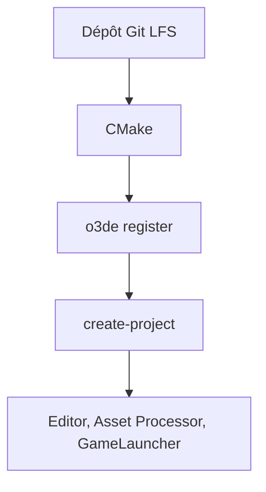

# o3de/o3de

> Open-source, real-time, cross-platform 3D engine, for creators of games and simulations.

## The problem
A commercial 3D engine imposes fees or obligations; this engine aims to do without them.

## What it actually does
Provides a 3D engine to build yourself from source, with an editor, an Asset Processor and a game launcher. The README describes building on Windows with CMake and Visual Studio, not how to use the engine.

## How it is wired
Simplified diagram based on the sheet, no diagram provided.



## Trying it
```bash
git lfs install
git clone https://github.com/o3de/o3de.git
scripts\o3de.bat register --this-engine
scripts\o3de.bat create-project --project-path <your new project path>
```

## Cost and gotchas
Free, but Git LFS, CMake 3.25 and Visual Studio 2019 are required, along with a third-party packages folder. The RAM needed is not quantified in the README: listed as a prerequisite to be safe. 3,525 open issues.

## What it is not
Not a data science tool. No ready-to-use installer in the README: you build it.

## Alternatives
No alternative named in the README.

## For you
Ignore: 3D game and simulation engine, unrelated to your field, unless you need visual simulation.
