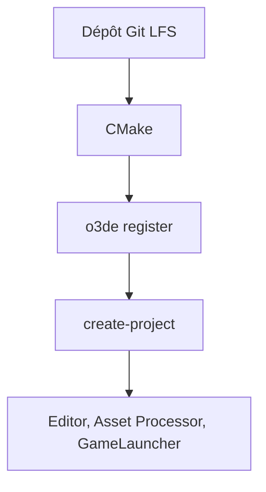

# o3de/o3de

> Moteur 3D open source temps réel et multiplateforme, pour créateurs de jeux et de simulations.

## Le problème
Un moteur 3D commercial impose des frais ou des obligations ; ce moteur vise à s'en passer.

## Ce que ça fait vraiment
Fournit un moteur 3D à compiler soi-même depuis les sources, avec un éditeur, un Asset Processor et un lanceur de jeu. Le README décrit la compilation sous Windows avec CMake et Visual Studio, pas l'usage du moteur.

## Comment c'est branché
Schéma simplifié d'après la fiche, sans diagramme fourni.



## Essayer
```bash
git lfs install
git clone https://github.com/o3de/o3de.git
scripts\o3de.bat register --this-engine
scripts\o3de.bat create-project --project-path <your new project path>
```

## Coût et pièges
Gratuit, mais Git LFS, CMake 3.25 et Visual Studio 2019 sont requis, avec un dossier de paquets tiers. La RAM nécessaire n'est pas chiffrée dans le README : valeur de prérequis par prudence. 3 525 issues ouvertes.

## Ce que ce n'est pas
Pas un outil de data science. Pas d'installeur prêt à l'emploi dans le README : on compile.

## Alternatives
Aucune alternative nommée dans le README.

## Pour toi
À ignorer : moteur de jeu et de simulation 3D, sans rapport avec ton métier, sauf besoin de simulation visuelle.

