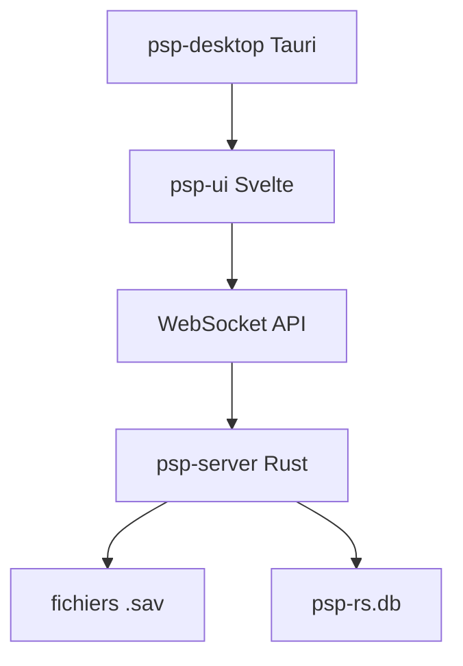

# oMaN-Rod/palworld-save-pal

> Palworld save editor: Pals, players, guilds, map and dedicated servers.

## The problem
Editing a game save by hand or migrating it between Steam, GamePass and a dedicated server is impossible without a tool.

## What it actually does
Desktop (Tauri) or web (Docker) application with a Rust backend `psp-server`, which replaced the Python backend. Edits Pals, inventories, technologies, guilds, map. Tools: Steam/GamePass conversion, UID swap, player transfer, raw JSON editor. Also manages dedicated servers and presets. An old `psp.db` database is imported automatically.

## How it is wired


## Trying it
```bash
git clone https://github.com/oMaN-Rod/palworld-save-pal.git
./scripts/build-docker.sh
docker compose up --build -d
```

## Cost and gotchas
Free. Back up the files before any edit. Breaking change: JSON files exported by the old Python tool can no longer be converted back to `.sav`. GPL-3.0 license.

## What it is not
Not an online cheating tool: it edits local files. Not a data science tool.

## Alternatives
- PalEdit, palworld-save-tools, PalWorldSaveTools: tools cited as neighbors or sources of inspiration.

## For you
Ignore: a game utility, unrelated to your profession; only the Python-to-Rust migration is a textbook case.
