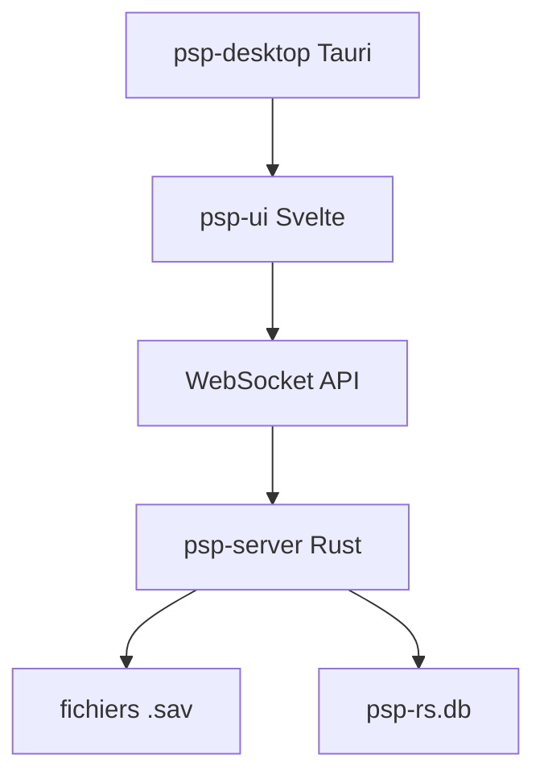

# oMaN-Rod/palworld-save-pal

> Éditeur de sauvegardes Palworld : Pals, joueurs, guildes, carte et serveurs dédiés.

## Le problème
Modifier une sauvegarde de jeu à la main ou la migrer entre Steam, GamePass et serveur dédié est impossible sans outil.

## Ce que ça fait vraiment
Application de bureau (Tauri) ou web (Docker) avec backend Rust `psp-server`, qui a remplacé le backend Python. Édite Pals, inventaires, technologies, guildes, carte. Outils : conversion Steam/GamePass, échange d'UID, transfert de joueur, éditeur brut JSON. Gère aussi des serveurs dédiés et des presets. Une base ancienne `psp.db` est importée automatiquement.

## Comment c'est branché


## Essayer
```bash
git clone https://github.com/oMaN-Rod/palworld-save-pal.git
./scripts/build-docker.sh
docker compose up --build -d
```

## Coût et pièges
Gratuit. Sauvegarder les fichiers avant toute édition. Rupture : les JSON exportés par l'ancien outil Python ne se reconvertissent plus en `.sav`. Licence GPL-3.0.

## Ce que ce n'est pas
Pas un outil de triche en ligne : il édite des fichiers locaux. Pas un outil de data science.

## Alternatives
- PalEdit, palworld-save-tools, PalWorldSaveTools : outils cités comme voisins ou sources d'inspiration.

## Pour toi
À ignorer : utilitaire de jeu, sans rapport avec ton métier ; seule la migration Python vers Rust est un cas d'école.

