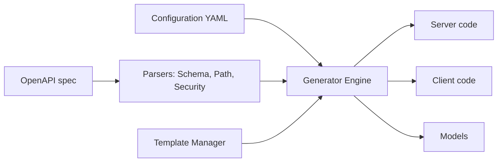

# oapi-codegen/oapi-codegen

> Tool and library that convert OpenAPI 3.0/3.1 specifications into Go code: server, client or models.

## The problem
Hand-writing the repetitive code of an HTTP server or client from an OpenAPI contract.

## What it actually does
A YAML configuration file drives the generation of models, servers (Chi, Echo, Fiber, Gin, gorilla/mux, Iris, `net/http`), clients and a "strict server" that simplifies signatures. It handles `allOf/anyOf/oneOf`, external references (import mapping), OpenAPI overlays, nullable types and `x-go-*` extensions. The code templates are overridable `text/template` files. Request validation goes through separate middlewares.

## How it is wired


## Trying it
```bash
go get -tool github.com/oapi-codegen/oapi-codegen/v2/cmd/oapi-codegen@latest
go install github.com/oapi-codegen/oapi-codegen/v2/cmd/oapi-codegen@latest
oapi-codegen -version
```
Then, in the code: `//go:generate go tool oapi-codegen -config cfg.yaml ../../api.yaml`.

## Cost and gotchas
Free. Go 1.25+ to build the tool. The import path changed (`deepmap` to `oapi-codegen`, from v2.3.0). Template overrides and the contents of `pkg/` are unstable.

## What it is not
It is not compatible with OpenAPI 2.0 (Swagger) without prior conversion. Response validation by middleware is not possible. It only generates Go.

## Alternatives
No alternative named in the README.

## For you
Ignore: it only produces Go code; useful only to an MLOps team that writes its API services in Go.
