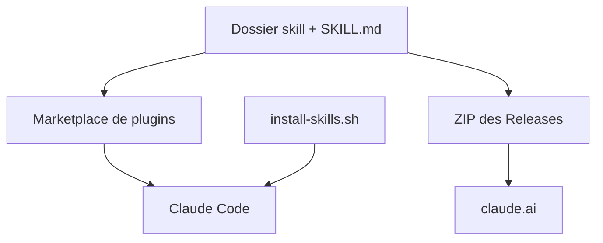

# oaustegard/claude-skills

> Collection of Claude skills distributed as a plugin marketplace for Claude Code and claude.ai.

## The problem
Finding, installing and updating Claude skills one by one is tedious.

## What it actually does
Repository of skills (a folder with `SKILL.md` and resources) installable as plugins via `/plugin marketplace add`, through an `install-skills.sh` script, or as a ZIP uploaded to claude.ai. Versions are released when `metadata.version` changes in the front matter. The skills primarily target the claude.ai compute environment; behavior may vary in Claude Code. The README does not list the content of each skill.

## How it is wired
Simplified diagram based on the sheet, no diagram provided.



## Trying it
```bash
/plugin marketplace add oaustegard/claude-skills
/plugin install skill-name@oaustegard-claude-skills
/plugin marketplace update
curl -fsSL https://raw.githubusercontent.com/oaustegard/claude-skills/main/templates/installation/install-skills.sh | bash
```

## Cost and gotchas
Free, but importing on claude.ai requires a paid account (Pro or Team). The installation script is run via `curl | bash`: read it first. The precise content of the skills is not described in the README.

## What it is not
Not a single product: a collection of disparate skills. Not designed primarily for Claude Code.

## Alternatives
No alternative named in the README.

## For you
Keep an eye on it: a pool of skills to browse for ideas, with no guarantee on each skill.
