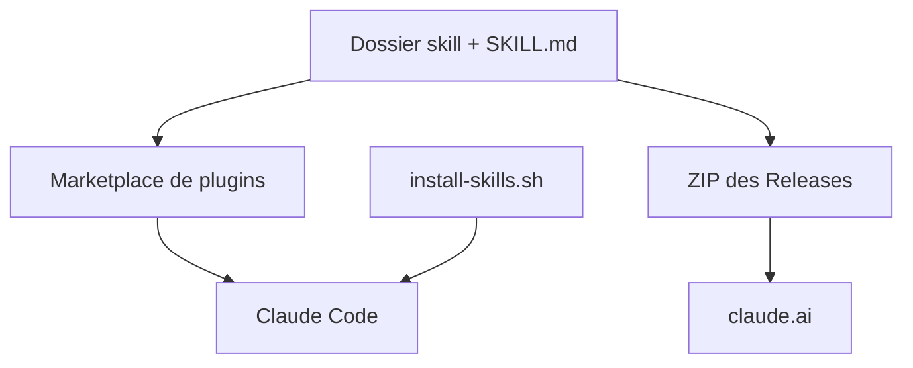

# oaustegard/claude-skills

> Collection de skills Claude distribuée comme place de marché de plugins pour Claude Code et claude.ai.

## Le problème
Retrouver, installer et mettre à jour des skills Claude un par un est fastidieux.

## Ce que ça fait vraiment
Dépôt de skills (dossier avec `SKILL.md` et ressources) installables comme plugins via `/plugin marketplace add`, par un script `install-skills.sh`, ou en ZIP téléversé dans claude.ai. Les versions sortent quand `metadata.version` change dans le front matter. Les skills visent d'abord l'environnement de calcul de claude.ai ; le comportement peut varier dans Claude Code. Le README ne liste pas le contenu de chaque skill.

## Comment c'est branché
Schéma simplifié d'après la fiche, sans diagramme fourni.



## Essayer
```bash
/plugin marketplace add oaustegard/claude-skills
/plugin install skill-name@oaustegard-claude-skills
/plugin marketplace update
curl -fsSL https://raw.githubusercontent.com/oaustegard/claude-skills/main/templates/installation/install-skills.sh | bash
```

## Coût et pièges
Gratuit, mais l'import sur claude.ai exige un compte payant (Pro ou Team). Le script d'installation est exécuté par `curl | bash` : lis-le avant. Le contenu précis des skills n'est pas décrit dans le README.

## Ce que ce n'est pas
Pas un produit unique : une collection de skills disparates. Pas conçu d'abord pour Claude Code.

## Alternatives
Aucune alternative nommée dans le README.

## Pour toi
À surveiller : un fonds de skills à parcourir pour y piocher des idées, sans garantie sur chaque skill.

