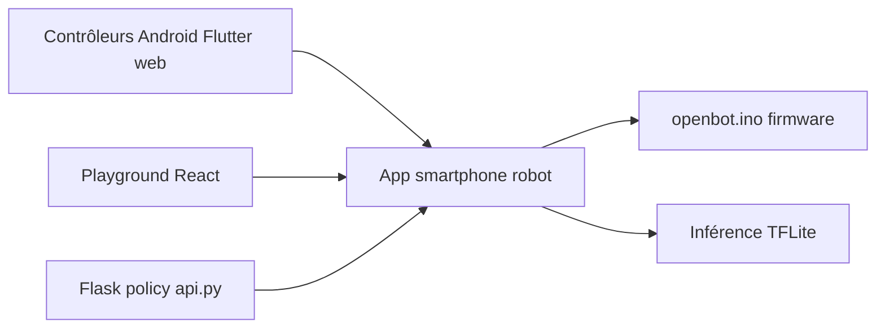

# ob-f/OpenBot

> Platform that turns a smartphone into the brain of a robot costing about 50 dollars.

## The problem
Building an autonomous mobile robot is expensive in sensors and compute; a smartphone already has them.

## What it actually does
Based on the described architecture: a robot body (CAD, boards), Arduino firmware (`openbot.ino`) for motors and sensors, Android and iOS apps that run perception (TFLite) and control, several controllers (Android, Flutter, Node.js, Python, web), a React "Playground" (Blockly) to program the robot, and a driving-policy learning stack (Python scripts, Flask API, React front end). The README itself is limited to links to the guides.

## How it is wired


## Trying it
```bash
git clone https://github.com/ob-f/OpenBot.git
```
The assembly, flashing and installation steps are in linked guides, not reproduced in the README.

## Cost and gotchas
The hardware is not free: a robot of about 50 dollars is advertised, plus a smartphone. The README asks you to read the disclaimer before starting.

## What it is not
Not a software-only project: it mixes hardware, firmware, mobile and ML. The detail of how it works comes from the generated architecture, not from the README.

## Alternatives
No alternative is cited in the README.

## For you
Ignore unless robotics is a hobby: outside the data/MLOps scope, even though driving-policy training is an example of embedded AI.
