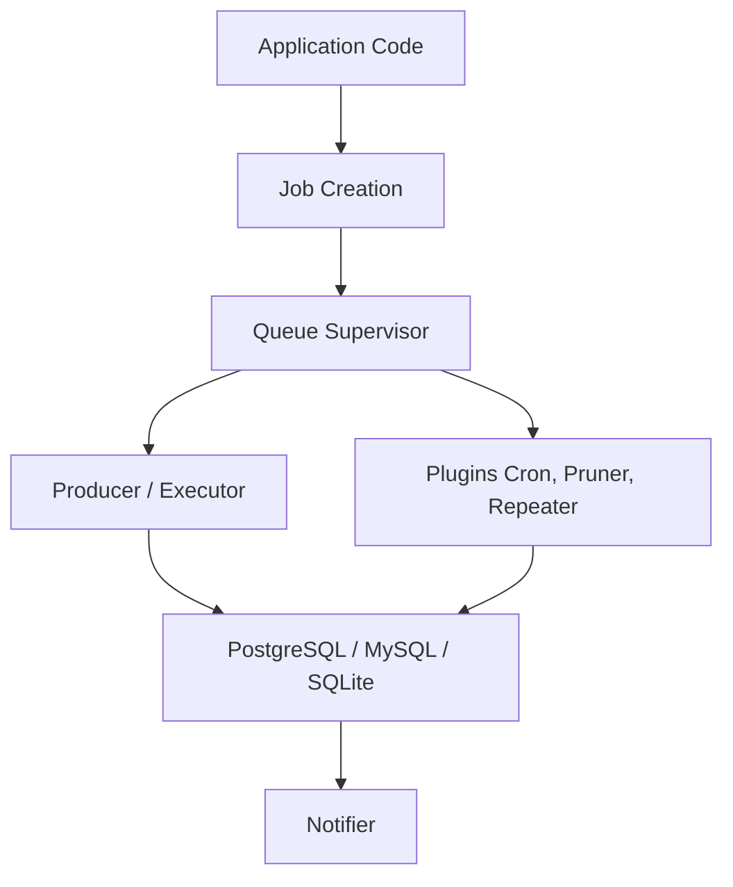

# oban-bg/oban

> Background job queue for Elixir, stored in PostgreSQL, MySQL or SQLite, for web application developers.

## The problem
Background tasks (emails, processing) get lost when a process crashes and often require Redis or one more broker to operate.

## What it actually does
Stores jobs in a table of your SQL database, runs them in isolated queues with their own concurrency limits, and keeps them after execution for metrics. Handles scheduled jobs, cron, unique jobs, priorities, cancellation during execution and graceful shutdown. Transactional insertion with your other writes. Lifecycle events come out through Telemetry.

## How it is wired


## Trying it
```bash
# In config/config.exs
config :my_app, Oban,
  repo: MyApp.Repo,
  queues: [mailers: 20]
```
Then define a worker with `use Oban.Worker, queue: :mailers` and insert with `MyApp.MailerWorker.new(args) |> Oban.insert()`.

## Cost and gotchas
Free for the core. Requires Elixir 1.15+, Erlang 24+ and a SQL database (PostgreSQL 14+, MySQL 8.4+, SQLite 3.37+). Global concurrency, workflows and batches are reserved for Oban Pro, a paid-license package.

## What it is not
Not usable outside the Elixir/Erlang ecosystem. According to the README, the engines do not all have the same production maturity. The advanced features of the Pro section are not included.

## Alternatives
No alternative named in the README.

## For you
Worth watching: an excellent reference for a SQL-backed job queue, but useful only if you write Elixir, which is rare in a data / MLOps profile.
