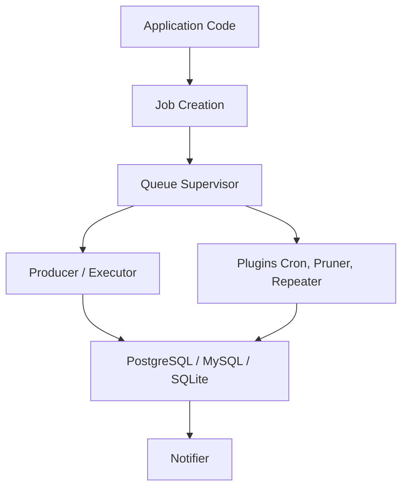

# oban-bg/oban

> File de jobs en arrière-plan pour Elixir, stockée dans PostgreSQL, MySQL ou SQLite, pour développeurs d'applications web.

## Le problème
Les tâches de fond (mails, traitements) se perdent au crash d'un process et demandent souvent Redis ou un broker de plus à exploiter.

## Ce que ça fait vraiment
Stocke les jobs dans une table de ta base SQL, les exécute par files isolées avec leurs limites de concurrence, et les garde après exécution pour les métriques. Gère jobs planifiés, cron, jobs uniques, priorités, annulation en cours d'exécution et arrêt propre. Insertion transactionnelle avec tes autres écritures. Les événements de cycle de vie sortent via Telemetry.

## Comment c'est branché


## Essayer
```bash
# In config/config.exs
config :my_app, Oban,
  repo: MyApp.Repo,
  queues: [mailers: 20]
```
Puis définir un worker avec `use Oban.Worker, queue: :mailers` et insérer avec `MyApp.MailerWorker.new(args) |> Oban.insert()`.

## Coût et pièges
Gratuit pour le cœur. Requiert Elixir 1.15+, Erlang 24+ et une base SQL (PostgreSQL 14+, MySQL 8.4+, SQLite 3.37+). Concurrence globale, workflows et batches sont réservés à Oban Pro, un paquet sous licence payante.

## Ce que ce n'est pas
Ce n'est pas utilisable hors de l'écosystème Elixir/Erlang. Les moteurs n'ont pas tous la même maturité en production selon le README. Les fonctions avancées de la section Pro ne sont pas incluses.

## Alternatives
Aucune alternative nommée dans le README.

## Pour toi
À surveiller : excellente référence de file de jobs adossée à SQL, mais utile seulement si tu écris du Elixir, ce qui est rare dans un profil data / MLOps.

