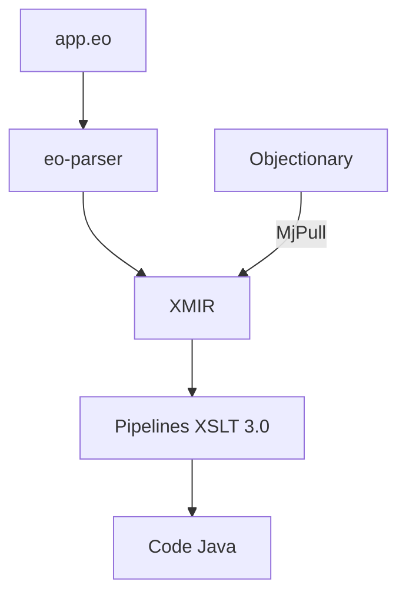

# objectionary/eo

> Experimental pure object-oriented language based on φ-calculus, compiled to Java via XMIR and XSLT.

## The problem
Mainstream object-oriented languages keep classes, null, types and mutability, which the authors consider incompatible with a true object model.

## What it actually does
EO knows only objects and their attributes, with no types, classes, null, operators or control statements; reuse goes through decoration (`@`). The parser converts the source into XMIR, an XML validated by an XSD, then XSLT 3.0 stylesheets normalize it and generate the code. Compilation is driven by a Maven plugin and the standard library is written in EO. External objects come from Objectionary.

## How it is wired
Simplified diagram based on the sheet, no diagram provided.



## Trying it
```bash
npm install -g eolang@0.37.1
eoc --easy link
eoc --easy --alone dataize app
```

## Cost and gotchas
Java SE and npm required. The first compilation can take a minute. Contributing requires Java 21 and a Maven build with the qulice profile.

## What it is not
Not a production language: the README calls it experimental. No link with the data / AI ecosystem.

## Alternatives
No alternative named, since the languages cited (Java, Ruby, Python, Smalltalk) are rejected by the authors.

## For you
Ignore: language research, with no use in data / AI / MLOps, but interesting for object theory.
