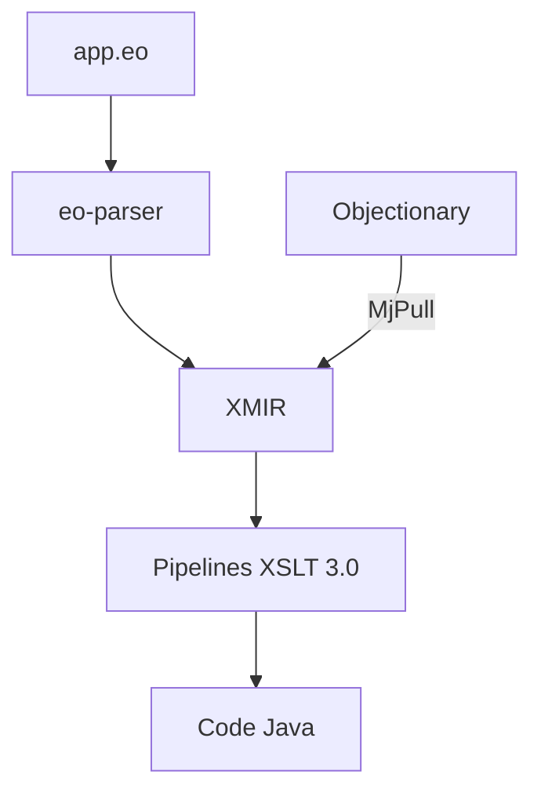

# objectionary/eo

> Langage orienté objet pur et expérimental, fondé sur le φ-calcul, compilé vers Java via XMIR et XSLT.

## Le problème
Les langages orientés objet usuels gardent classes, null, types et mutabilité, que les auteurs jugent incompatibles avec un vrai modèle objet.

## Ce que ça fait vraiment
EO ne connaît que des objets et leurs attributs, sans types, classes, null, opérateurs ni instructions de contrôle ; la réutilisation passe par la décoration (`@`). Le parseur convertit le source en XMIR, un XML validé par un XSD, puis des feuilles XSLT 3.0 normalisent et génèrent le code. La compilation se pilote par un plugin Maven et la bibliothèque standard est écrite en EO. Les objets externes viennent d'Objectionary.

## Comment c'est branché
Schéma simplifié d'après la fiche, sans diagramme fourni.



## Essayer
```bash
npm install -g eolang@0.37.1
eoc --easy link
eoc --easy --alone dataize app
```

## Coût et pièges
Java SE et npm requis. La première compilation peut durer une minute. Contribuer exige Java 21 et un build Maven avec le profil qulice.

## Ce que ce n'est pas
Pas un langage de production : le README le qualifie d'expérimental. Aucun lien avec l'écosystème data / IA.

## Alternatives
Aucune alternative nommée, les langages cités (Java, Ruby, Python, Smalltalk) étant rejetés par les auteurs.

## Pour toi
À ignorer : une recherche de langage, sans usage en data / IA / MLOps, mais intéressante pour la théorie des objets.

