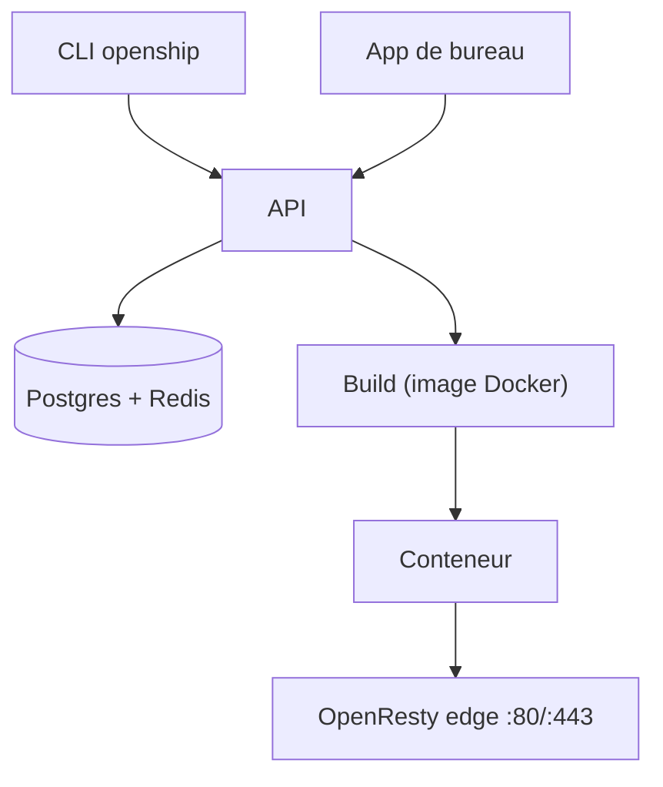

# oblien/openship

> Self-hostable deployment platform with built-in CI/CD, driven by app, dashboard or CLI.

## The problem
Deploying an application on your own server means assembling build, routing, TLS certificates and continuous deployment by hand.

## What it actually does
Pointed at a repo, a folder or an artifact, it detects the stack, builds a Docker image or a release, starts the container, then routes and secures with OpenResty and Let's Encrypt. A GitHub webhook redeploys on every push. Handles databases, domains, mail and backups. Compose in Linux mode with Docker, bare mode elsewhere.

## How it is wired


## Trying it
```bash
curl -fsSL https://get.openship.io | sh
openship
openship up --public-url https://openship.example.com
cd your-project && openship init && openship deploy
```

## Cost and gotchas
Self-hosting is free. The api container mounts the host's Docker socket: reserve it for a trusted host. Node 22+ required for the npm install. Push-to-deploy requires an always-on server.

## What it is not
Not a hosting provider: it deploys to your server or to its Cloud. The README says "production-ready core"; judge it on the evidence, the project dates from March 2026.

## Alternatives
No alternative named in the README.

## For you
Worth watching: useful for deploying ML demos or services on a VPS, but young and highly privileged.
