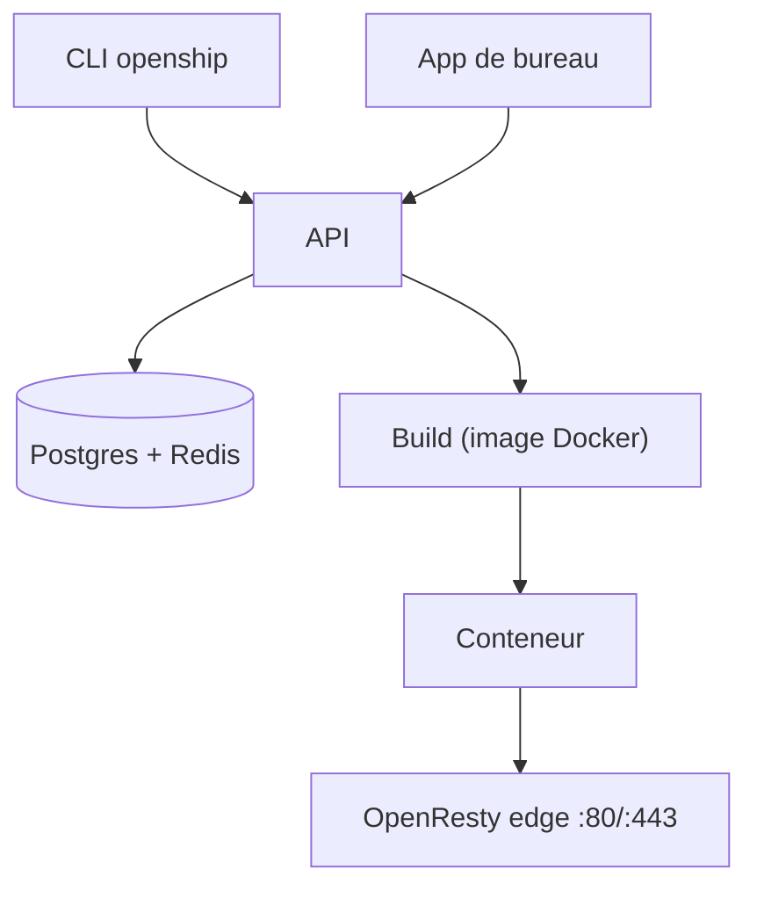

# oblien/openship

> Plateforme de déploiement auto-hébergeable avec CI/CD intégrée, pilotable par application, tableau de bord ou CLI.

## Le problème
Déployer une application sur son propre serveur oblige à assembler build, routage, certificats TLS et déploiement continu à la main.

## Ce que ça fait vraiment
Pointée sur un dépôt, un dossier ou un artefact, elle détecte la stack, construit une image Docker ou une release, lance le conteneur, puis route et sécurise avec OpenResty et Let's Encrypt. Un webhook GitHub redéploie à chaque push. Gère bases de données, domaines, mail et sauvegardes. Compose en mode Linux avec Docker, mode bare ailleurs.

## Comment c'est branché


## Essayer
```bash
curl -fsSL https://get.openship.io | sh
openship
openship up --public-url https://openship.example.com
cd your-project && openship init && openship deploy
```

## Coût et pièges
Auto-hébergement gratuit. Le conteneur api monte le socket Docker de l'hôte : à réserver à un hôte de confiance. Node 22+ requis pour l'installation npm. Push-to-deploy exige un serveur toujours allumé.

## Ce que ce n'est pas
Pas un hébergeur : il déploie vers ton serveur ou son Cloud. Le README dit « production-ready core » ; à juger sur pièces, le projet date de mars 2026.

## Alternatives
Aucune alternative nommée dans le README.

## Pour toi
À surveiller : utile pour déployer des démos ou services ML sur un VPS, mais jeune et à privilèges élevés.

