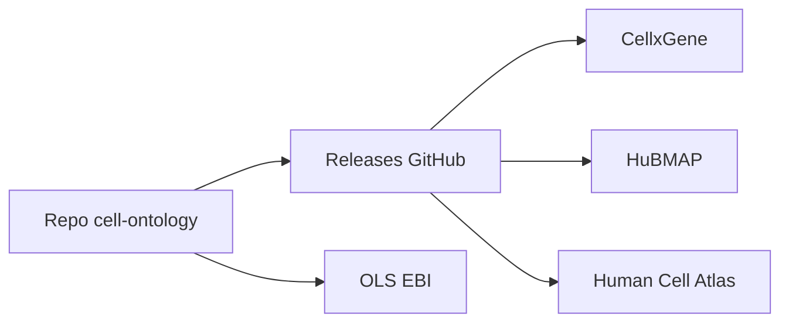

# obophenotype/cell-ontology

> Source of the CL cell type ontology, a reference for annotating single-cell biology data.

## The problem
Single-cell transcriptomics datasets name cell types inconsistently, which prevents comparing them.

## What it actually does
Hosts the source files of the CL ontology and its tracker for requests for new terms. The ontology is used by CellxGene, HuBMAP, Human Cell Atlas, Single Cell Expression Atlas, ENCODE or FANTOM5. Published versions are to be fetched from the releases.

## How it is wired

Simplified diagram based on the sheet, no diagram provided.

## Trying it
No documented command. Browse the ontology at https://www.ebi.ac.uk/ols4/ontologies/cl or download the latest release from the repository's Releases page.

## Cost and gotchas
Free. The README describes no installation procedure. The repository has 375 open issues: editing follows a flow of requests and reviews.

## What it is not
Not a Python library: these are ontology files. Not a repository to modify directly: most users do not need to edit its content.

## Alternatives
None named in the README (Uberon is cited as a neighbouring ontology).

## For you
Relevant if you annotate or harmonize single-cell data: it is the de facto reference. Outside biology, irrelevant.
