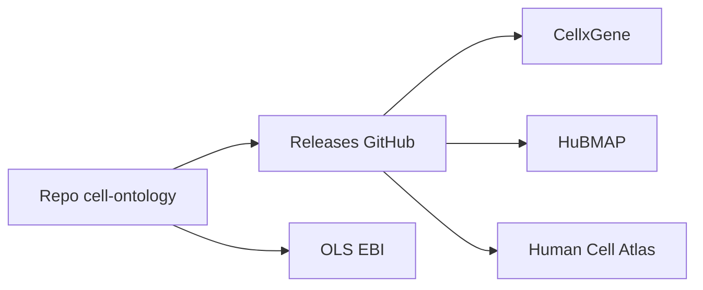

# obophenotype/cell-ontology

> Source de l'ontologie des types cellulaires CL, référence pour annoter les données de biologie unicellulaire.

## Le problème
Les jeux de données de transcriptomique unicellulaire nomment les types de cellules de façon incohérente, ce qui empêche de les comparer.

## Ce que ça fait vraiment
Héberge les fichiers sources de l'ontologie CL et son suivi de demandes de nouveaux termes. L'ontologie est utilisée par CellxGene, HuBMAP, Human Cell Atlas, Single Cell Expression Atlas, ENCODE ou FANTOM5. Les versions publiées sont à récupérer dans les releases.

## Comment c'est branché

Schéma simplifié d'après la fiche, sans diagramme fourni.

## Essayer
Aucune commande documentée. Parcourir l'ontologie sur https://www.ebi.ac.uk/ols4/ontologies/cl ou télécharger la dernière release sur la page Releases du dépôt.

## Coût et pièges
Gratuit. Le README ne décrit pas de procédure d'installation. Le dépôt compte 375 issues ouvertes : l'édition suit un flux de demandes et de revues.

## Ce que ce n'est pas
Pas une bibliothèque Python : ce sont des fichiers d'ontologie. Pas un dépôt à modifier directement : la plupart des utilisateurs n'ont pas besoin d'éditer son contenu.

## Alternatives
Aucune nommée dans le README (Uberon est cité comme ontologie voisine).

## Pour toi
Pertinent si tu annotes ou harmonises des données unicellulaires : c'est le référentiel de fait. Hors biologie, sans objet.

