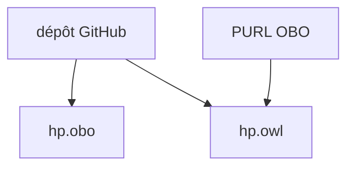

# obophenotype/human-phenotype-ontology

> Human Phenotype Ontology (HPO), to download in OBO or OWL, for biomedical research.

## The problem
Describing clinical abnormalities in a standardized way to link diseases, genes and patients.

## What it actually does
The README is minimal: it gives the download URLs (`hp.obo`, `hp.owl` via OBO PURL), the project page, the issue tracker and contacts. The content of the ontology is not described: not documented here.

## How it is wired


## Trying it
```bash
curl -L http://purl.obolibrary.org/obo/hp.obo -o hp.obo
```
The URLs come from the README; the curl command is the user's own writing.

## Cost and gotchas
Free. A license is present but not identified by GitHub: check it before reuse, especially with health data. 195 open issues.

## What it is not
Not a tool or an API: a reference file to integrate.

## Alternatives
No alternative named in the README.

## For you
Worth watching: useful if you do biomedical NLP or knowledge graphs, but check the license before any use.
