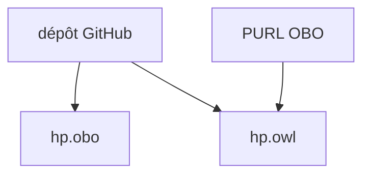

# obophenotype/human-phenotype-ontology

> Ontologie des phénotypes humains (HPO), à télécharger en OBO ou OWL, pour la recherche biomédicale.

## Le problème
Décrire les anomalies cliniques de façon normalisée pour relier maladies, gènes et patients.

## Ce que ça fait vraiment
Le README est minimal : il donne les URL de téléchargement (`hp.obo`, `hp.owl` via PURL OBO), la page du projet, le suivi des tickets et des contacts. Le contenu de l'ontologie n'est pas décrit : non documenté ici.

## Comment c'est branché


## Essayer
```bash
curl -L http://purl.obolibrary.org/obo/hp.obo -o hp.obo
```
Les URL viennent du README ; la commande curl est une écriture de l'utilisateur.

## Coût et pièges
Gratuit. Licence présente mais non identifiée par GitHub : vérifier avant réutilisation, surtout avec des données de santé. 195 issues ouvertes.

## Ce que ce n'est pas
Pas un outil ni une API : un fichier de référence à intégrer.

## Alternatives
Aucune alternative nommée dans le README.

## Pour toi
À surveiller : utile si tu fais du NLP ou du graphe de connaissances biomédical, mais vérifie la licence avant tout usage.

