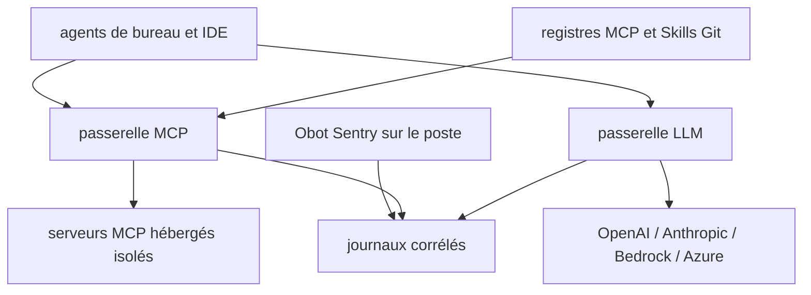

# obot-platform/obot

> Governance platform that centralizes access to models, MCP servers, skills and AI activity logs.

## The problem
Each workstation installs its own MCP servers, skills and provider keys, with no inventory or control.
Nothing links what happens on users' machines to what goes through the hosted services.

## What it actually does
Two gateways: MCP, a single entry point to authorized servers, with composite servers, request filters and OAuth and secrets management; LLM, which presents provider-compatible endpoints and keeps credentials on the Obot side.
Runs `npx`, `uvx` and containerized MCP servers in isolated environments — Docker containers or Kubernetes workloads — with per-domain egress rules.
MCP and Skills registries backed by Git catalogs, exposed through the standard MCP registry API, with access policies per entry, repository or catalog.
Obot Sentry, in beta, inventories what is installed on workstations, installs hooks for Claude Code, Codex, Cursor and VS Code, and records local tool calls.

## How it is wired


## Trying it
```bash
docker run -d \
  --name obot \
  -p 8080:8080 \
  -v obot-data:/data \
  -v /var/run/docker.sock:/var/run/docker.sock \
  -e OBOT_SERVER_ENABLE_AUTHENTICATION=true \
  -e OBOT_BOOTSTRAP_TOKEN=<token> \
  ghcr.io/obot-platform/obot:latest
```

## Cost and gotchas
This Docker configuration mounts the host's Docker socket: the README reserves it for development, evaluation or a trusted single-tenant environment.
The bootstrap token must be at least six characters, and if omitted Obot generates one in the container logs.
A model provider is only required for the LLM gateway; external PostgreSQL and encryption are covered by the Kubernetes guide.

## What it is not
Not an AI client: Obot does not replace Claude Code, Cursor or an IDE — it frames what they reach.
Not production-ready on Docker: Kubernetes deployment is the recommended path as soon as there are several tenants.
Fleet management (Sentry) is explicitly in beta.

## Alternatives
No alternative named in the README.

## For you
The right tool the day a whole team uses agents and you need to say who called what; far too heavy for solo use.
