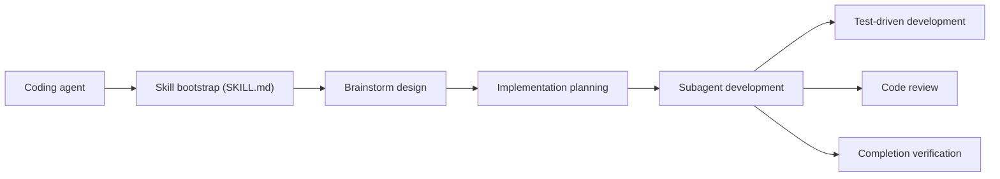

# obra/superpowers

> A skills library that enforces a specific methodology on a developer: scoping, planning, Test-Driven Development (TDD), and code review.

## The problem
A developer starts writing code before fully understanding the requirements, without a plan or any testing, and spends extended periods on the task.

## What it actually does
Several features are automatically triggered: brainstorming before writing any code, an isolated Git worktree, a plan divided into tasks of 2 to 5 minutes, execution by sub-agents with a review after each task, TDD (red-green-refactor), verification before concluding, and systematic debugging. It can be installed as a plugin in many IDEs (Claude Code, Codex, Cursor, Gemini CLI, OpenCode, Pi…).

## How it is wired


## Trying it
```bash
/plugin install superpowers@claude-plugins-official
/plugin marketplace add obra/superpowers-marketplace
/plugin install superpowers@superpowers-marketplace
```

## Cost and gotchas
Free of charge, but the agent works for several hours independently: the cost of the tokens is your responsibility. The logo for the visual assistant is downloaded from the publisher's website, along with the version (which can be disabled using `SUPERPOWERS_DISABLE_TELEMETRY`).

## What it is not
Not a suggestion: workflows are "mandatory" for the agent. Not an independent tool for the agent: the effectiveness depends on how well the system aligns with the agent's skills. Direct customer support is available.

## Alternatives
- Matt Pocock Skills, Everything Claude Code, Spec Kit: Other methodologies mentioned in the README of the neighboring repository, which are not detailed here.
- Pi: a harness where Superpowers is installed as a package.

## For you
Recommended approach: Implement Test-Driven Development (TDD) along with a well-defined plan and regular code reviews, specifically for data pipelines or MLOps; test this approach on a small project before applying it more broadly.
