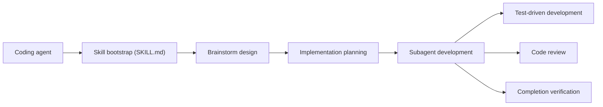

# obra/superpowers

> Bibliothèque de skills qui impose à un agent de code une méthode : cadrage, plan, TDD, revue.

## Le problème
Un agent de code se lance dans l'écriture avant d'avoir clarifié le besoin, sans plan ni tests, et dérive sur de longues sessions.

## Ce que ça fait vraiment
Des skills se déclenchent automatiquement : brainstorming avant tout code, worktree git isolé, plan découpé en tâches de 2 à 5 minutes, exécution par sous-agents avec revue après chaque tâche, TDD rouge-vert-refactor, vérification avant de conclure, débogage systématique. Installable comme plugin dans de nombreux harnais (Claude Code, Codex, Cursor, Gemini CLI, OpenCode, Pi…).

## Comment c'est branché


## Essayer
```bash
/plugin install superpowers@claude-plugins-official
/plugin marketplace add obra/superpowers-marketplace
/plugin install superpowers@superpowers-marketplace
```

## Coût et pièges
Gratuit, mais l'agent travaille plusieurs heures de façon autonome : la facture de tokens est à ta charge. Le logo du companion visuel est chargé depuis le site de l'éditeur avec la version (désactivable par `SUPERPOWERS_DISABLE_TELEMETRY`).

## Ce que ce n'est pas
Pas une suggestion : les workflows sont « obligatoires » pour l'agent. Pas un outil indépendant de l'agent : l'effet dépend de la fidélité du harnais aux skills. Du support commercial est proposé en contact direct.

## Alternatives
- Matt Pocock Skills, Everything Claude Code, Spec Kit : autres méthodologies citées dans le README du dépôt voisin, non détaillées ici.
- Pi : harnais où Superpowers s'installe comme package.

## Pour toi
À adopter : une méthode TDD + plan + revue cadre efficacement un agent sur des pipelines data ou MLOps ; à tester sur un petit projet avant de généraliser.

