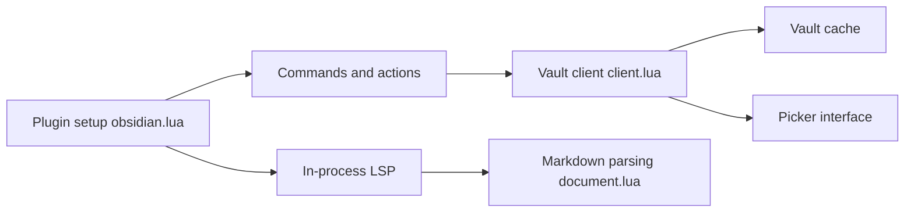

# obsidian-nvim/obsidian.nvim

> Neovim plugin, community fork, to work in Obsidian vaults without leaving the editor.

## The problem
Editing Obsidian notes in Neovim without navigation, links, backlinks or note completion.

## What it actually does
An `:Obsidian` command: daily notes, templates, search (ripgrep), backlinks, renaming with link updates, image pasting, frontmatter properties. Completion goes through an in-process LSP. Obsidian Sync is possible via obsidian-headless (disabled by default).

## How it is wired


## Trying it
```bash
:checkhealth obsidian
:Obsidian quick_switch
:Obsidian today
```

## Cost and gotchas
Free. Neovim >= 0.11, ripgrep, a picker of your choice. `xclip`, `pngpaste` or `wl-clipboard` to paste images. The `main` README may describe unreleased features.

## What it is not
Does not replace the Obsidian application (no graph view, no mobile). Refactoring commands will migrate to code actions in 3.17.0.

## Alternatives
The original repository epwalsh/obsidian.nvim, poorly maintained according to the README.

## For you
Ignore: it serves those who take notes in Neovim; no link with data/AI work.
