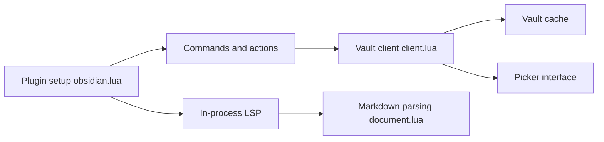

# obsidian-nvim/obsidian.nvim

> Plugin Neovim, fork communautaire, pour travailler dans des coffres Obsidian sans quitter l'éditeur.

## Le problème
Éditer des notes Obsidian dans Neovim sans navigation, liens, backlinks ni complétion de notes.

## Ce que ça fait vraiment
Une commande `:Obsidian` : notes quotidiennes, templates, recherche (ripgrep), backlinks, renommage avec mise à jour des liens, collage d'images, propriétés frontmatter. Une complétion passe par un LSP en processus. Obsidian Sync est possible via obsidian-headless (désactivé par défaut).

## Comment c'est branché


## Essayer
```bash
:checkhealth obsidian
:Obsidian quick_switch
:Obsidian today
```

## Coût et pièges
Gratuit. Neovim >= 0.11, ripgrep, un picker au choix. `xclip`, `pngpaste` ou `wl-clipboard` pour coller des images. Le README `main` peut décrire des fonctions non publiées.

## Ce que ce n'est pas
Ne remplace pas l'application Obsidian (pas de vue graphe, pas de mobile). Des commandes de refactoring migreront vers les code actions en 3.17.0.

## Alternatives
Le dépôt d'origine epwalsh/obsidian.nvim, peu maintenu selon le README.

## Pour toi
Ignorer : il sert à ceux qui prennent leurs notes sous Neovim ; aucun lien avec un travail data/IA.

